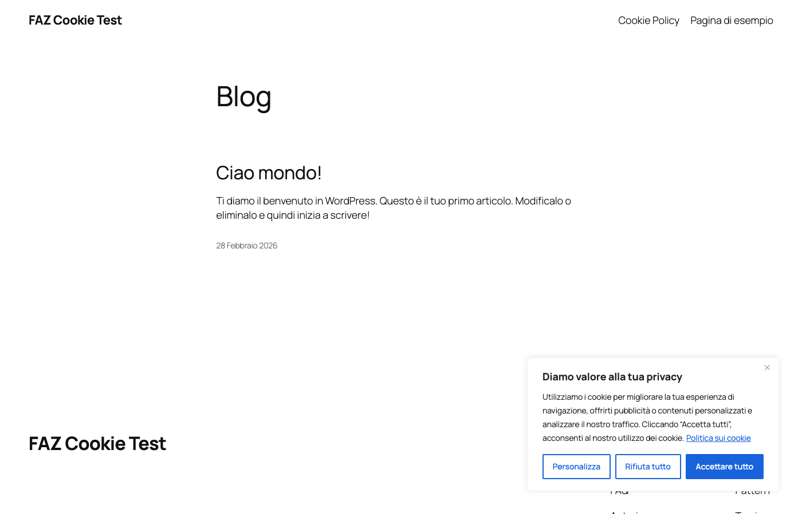
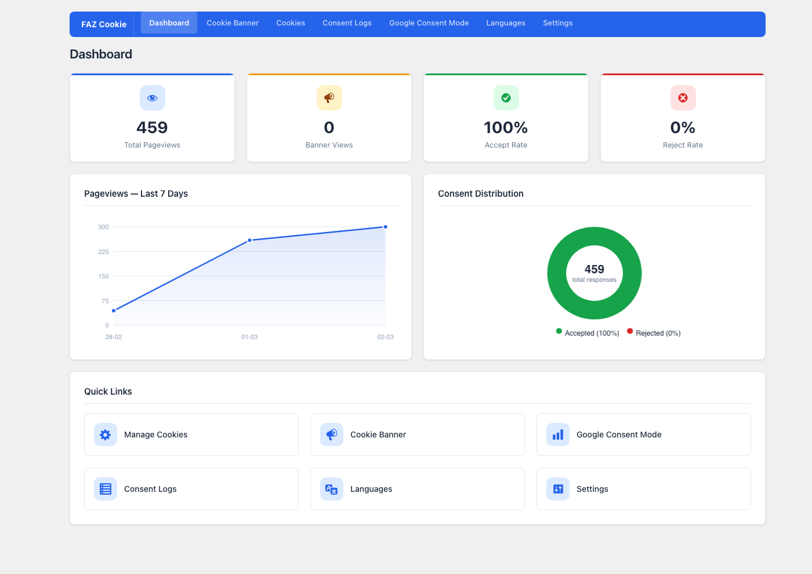
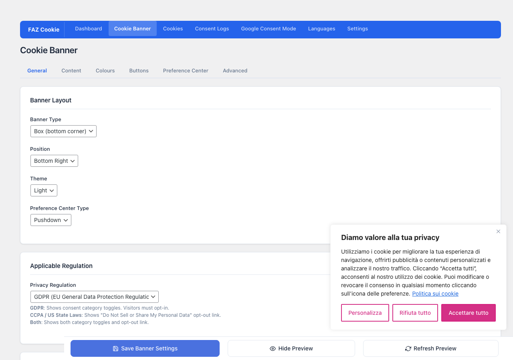
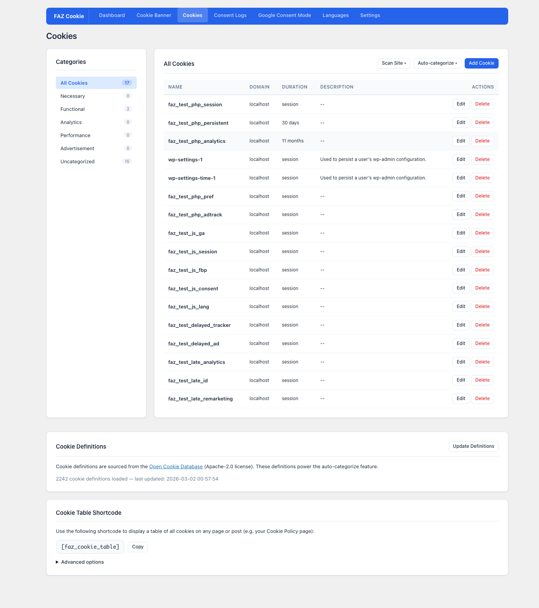
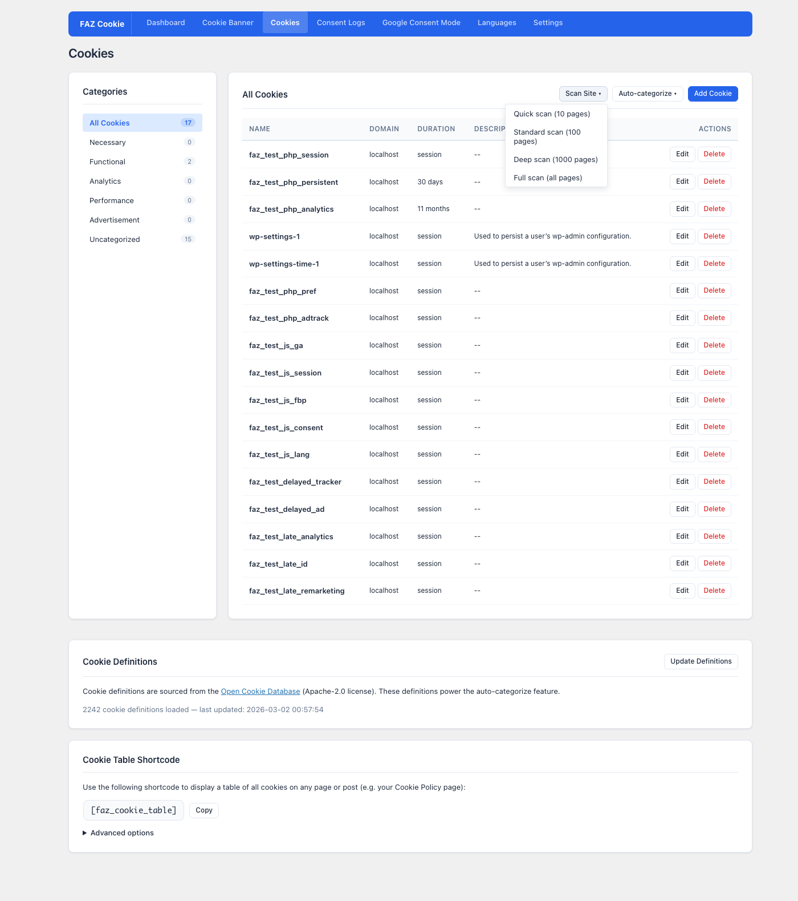
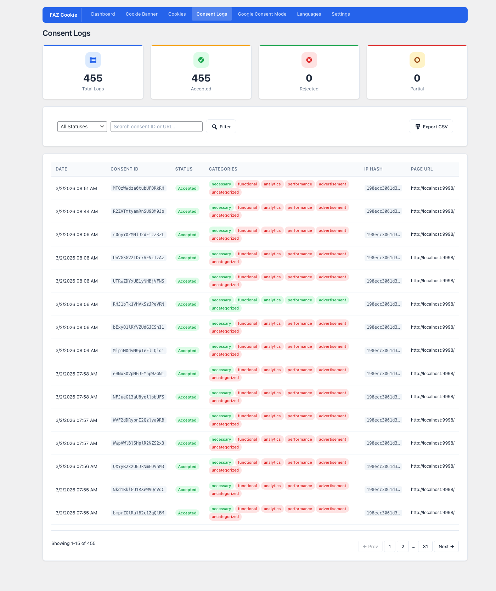
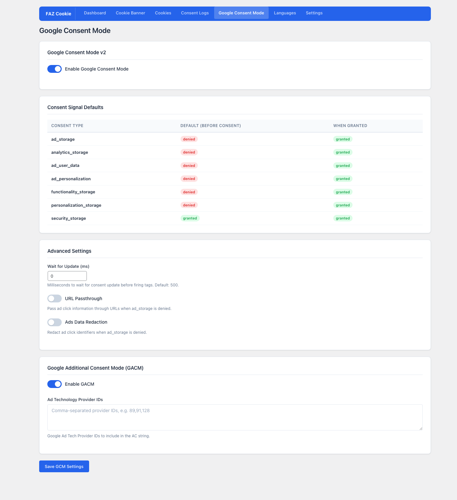
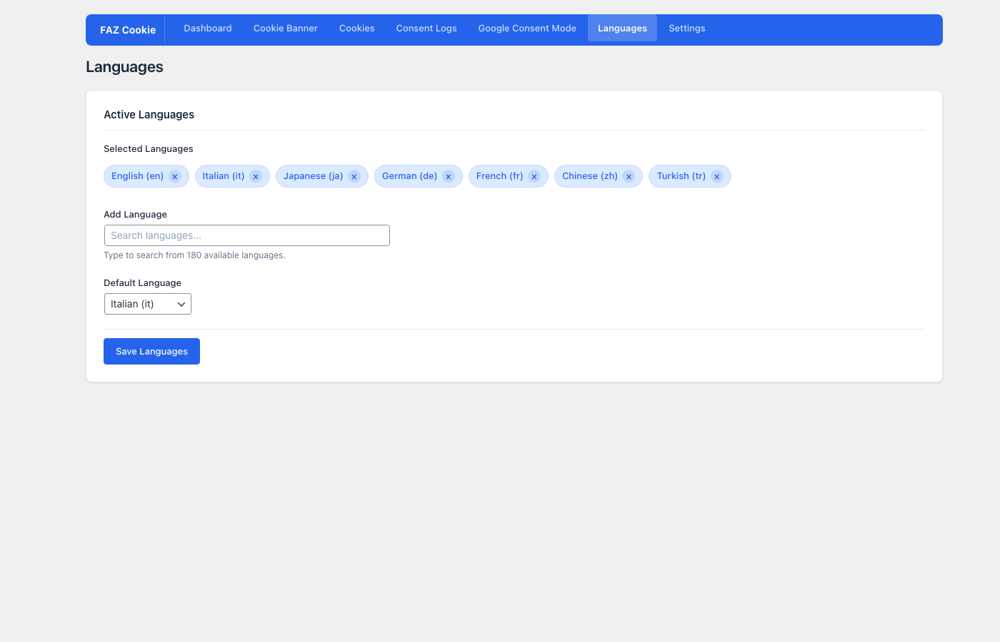
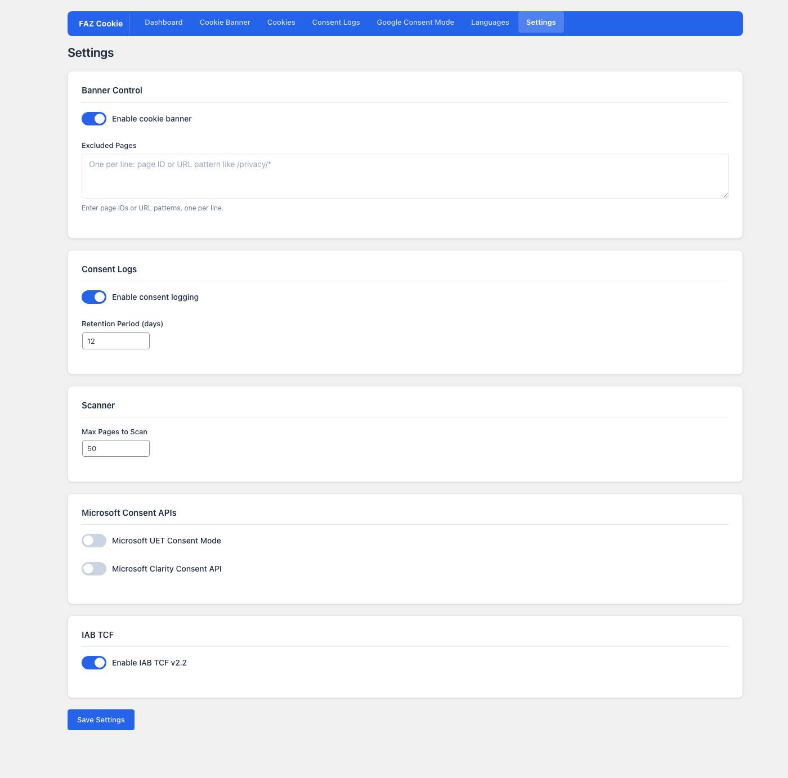

# FAZ Cookie Manager

**The only cookie consent plugin you need. 100% free, no required cloud account, no subscriptions.**

[](https://wordpress.org/plugins/faz-cookie-manager/)
[](https://wordpress.org/plugins/faz-cookie-manager/reviews/)
[](https://wordpress.org/plugins/faz-cookie-manager/)
[](LICENSE)
[](https://playground.wordpress.net/?plugin=faz-cookie-manager)

Available on the [WordPress.org plugin directory](https://wordpress.org/plugins/faz-cookie-manager/) — install and update directly from your WordPress dashboard (**Plugins > Add New > search "FAZ Cookie Manager"**).

---

**Tired of cookie consent plugins that lock essential features behind paywalls, require cloud accounts, or send your visitors' data to third-party servers?**

FAZ Cookie Manager is a WordPress plugin that helps you implement cookie consent and privacy workflows for international regulations -- completely free, with no strings attached.

No account to create. No required cloud service to connect. No "premium" plan to unlock basic features like consent logging or geo-targeting. Core consent features run on your own server, and you own all your data.

## Why FAZ Cookie Manager?

Most cookie consent plugins follow the same pattern: a free version with crippled features, and a paid tier starting at $10-50/month that unlocks what you actually need. FAZ Cookie Manager breaks that model:

| Feature | Others (free) | Others (paid) | FAZ Cookie Manager |
|---|---|---|---|
| Cookie banner | Limited | Full | **Full** |
| Cookie scanner | No | Yes | **Yes** |
| Consent logging + CSV export | No | Yes | **Yes** |
| Google Consent Mode v2 | No | Yes | **Yes** |
| IAB TCF v2.3 + GVL | No | Yes | **Yes** |
| Geo-targeting | No | Yes | **Yes** |
| Multi-language (180+) | No | Yes | **Yes** |
| Cookie Policy generator | Paid add-on | Yes | **Yes (NEW in 1.16.0)** |
| Editable Cookie Policy sections, per language | Paid add-on | Yes | **Yes** |
| Guided setup wizard | Rarely | Yes | **Yes (NEW in 1.25.0)** |
| Editable Cookie Policy text (any language) | No | Rarely | **Yes (NEW in 1.25.0)** |
| A/B testing of banner variants | No | Rarely | **Yes (NEW in 1.25.0)** |
| Schrems II per-cookie transfer disclosure | No | Rarely | **Yes (NEW in 1.25.0)** |
| Age-appropriate consent (GDPR Art. 8) | No | Rarely | **Yes (NEW in 1.25.0)** |
| Cloud dependency | No | **Yes** | **No** |
| Price | Free | $10-50/mo | **Free forever** |

> **A note on IAB TCF v2.3:** The plugin includes a fully functional IAB TCF v2.3 CMP implementation -- TC String encoding, GVL integration, vendor consent UI, and all required `__tcfapi()` commands work correctly. However, for the TC String to be recognized by the ad-tech supply chain, the CMP must be registered with IAB Europe (which requires an annual fee). CMP registration is on the roadmap. If you'd like to help make it happen, consider supporting the project:
>
> [](https://buymeacoffee.com/fabiodalez)

---

## Screenshots

### Cookie Consent Banner
Consent banner with Customize, Reject All, and Accept All buttons. Appears on first visit, fully responsive and keyboard accessible.



### Dashboard
Analytics overview with pageviews chart, consent distribution (accept/reject rates), and quick links to all plugin sections.



### Cookie Banner Editor
Customize layout (box, bar, popup), position, theme (light/dark), and regulation type (GDPR/CCPA/both) with a live preview. Includes tabs for Content, Colours, Buttons, Preference Center, and Advanced settings.



### Cookies Management
View all detected cookies organized by category (Necessary, Functional, Analytics, Performance, Advertisement). Edit, delete, or add cookies manually. Integrated with the Open Cookie Database (2,242 definitions) for automatic categorization.



### Cookie Scanner
Built-in browser-based scanner with multiple scan depths: Quick (10 pages), Standard (100), Deep (1,000), or Full scan. Runs locally -- no external service, no API limits.



### Consent Logs
Complete audit trail of every visitor's consent decision. Shows consent ID, status, categories chosen, a pseudonymised IP (salted one-way hash), and page URL. Search, filter, and export to CSV for GDPR accountability.



### Google Consent Mode v2
Configure all 7 consent signal types with default and granted states. Includes Google Additional Consent Mode (GACM) for ad technology provider IDs.



### Languages
Select from 180+ available languages. The banner text adapts automatically to the visitor's browser language.



### Settings
Global controls: enable/disable banner, exclude pages, consent log retention, scanner limits, Microsoft UET/Clarity consent APIs, and IAB TCF v2.3 toggle with CMP ID and Purpose One Treatment options.



---

## Compliance

| Standard | Status | Details |
|----------|--------|---------|
| GDPR (EU) | Assists | Opt-in model, granular consent, right to withdraw |
| ePrivacy Directive | Assists | Consent-based script blocking support |
| CCPA / CPRA (California) | Supported | "Do Not Sell" opt-out, GPC signal detection |
| Garante Privacy LG 2021 (Italy) | Assists | Equal-weight buttons, no scroll-as-consent, 6-month max expiry option |
| EDPB Guidelines | Assists | Scroll != consent, no pre-checked categories, equal button prominence |
| IAB TCF v2.3 | Supports | Full `__tcfapi()` CMP, GVL integration, vendor consent UI, DisclosedVendors segment |
| Google Consent Mode v2 | Supports | Default-denied signals, consent update on interaction |
| LGPD (Brazil) | Supported | Consent-based model |
| POPIA (South Africa) | Supported | Conservative consent-based preset (s.11(1)(a)); other s.11(1)(b)-(f) justifications require separate assessment |
| WCAG 2.1 AA | Accessibility-focused | Keyboard navigation, focus indicators, ARIA labels |
| WP Consent API | Supports | Registered via `wp_consent_api_registered_` filter |

> **Legal Disclaimer:** Compliance status depends on correct plugin configuration for your specific use case and does not constitute a legal guarantee. This table is for informational purposes only and is not legal advice. Consult a qualified legal professional for your jurisdiction.

### Automated Compliance Tests

Playwright tests verify consent behavior and policy-oriented safeguards at runtime:

- TF01-TF18: Full functional test suite covering banner display, cookie blocking, consent flow, mobile, accessibility, revocation, logging, GCM signals, and cookie declarations
- P05: No ambiguous button labels (dark pattern check)
- G07: Non-technical toggles OFF by default
- I08: Technical cookies non-disableable
- T01-T03: IAB TCF `__tcfapi` CMP stub, TC String format, cross-frame messaging
- GCM01-GCM05: Google Consent Mode default-denied, granted on accept, revocation
- CD01-CD03: Cookie declarations, descriptions, categories
- VIS01-VIS09: Visual integrity checks across banner types and preference centers
- IAB01-IAB39: IAB Settings page, GVL admin page, vendor selection, TC String validation

**The test suite includes automated consent, privacy, accessibility, and integration checks across frontend, admin, scanner, GCM/TCF, visual integrity, and IAB flows.**

---

## Installation

### From the WordPress.org plugin directory (recommended)

1. In your WordPress dashboard go to **Plugins > Add New Plugin**
2. Search for **FAZ Cookie Manager**
3. Click **Install Now**, then **Activate**
4. Go to **FAZ Cookie** in the admin sidebar
5. Click **Scan Site** on the Cookies page to detect cookies
6. Customize banner design, text, and regulation type

Automatic updates are handled by WordPress — no manual steps needed.

### From GitHub (developers)

1. Download the latest release from [GitHub Releases](https://github.com/fabiodalez-dev/FAZ-Cookie-Manager/releases)
2. Upload the `faz-cookie-manager` folder to `/wp-content/plugins/`
3. Activate in **WordPress admin > Plugins**

### Requirements

- WordPress 5.0+
- PHP 7.4+
- MySQL/MariaDB
- Built-in Open Cookie Database snapshot included; `Update Definitions` refreshes it from GitHub.
- Core consent features run locally. Optional refresh/download features may contact GitHub, IAB Europe, MaxMind, or the AMP CDN depending on which features you enable and use.

---

## Features (detailed)

### Guided Setup Wizard (NEW in 1.25.0)

An eight-step first run that configures the plugin for your jurisdiction instead of leaving you on a generic default.

- **Environment detection**: finds your multilingual plugin, page cache, WooCommerce and any pre-existing consent data, and adapts the recommendations to what it sees.
- **Plain-language choices**: every option explains what it does and what it costs. The more protective option is pre-selected; nothing nudges toward weaker settings.
- **Never nags an existing install**: upgrading sites are treated as already onboarded. The wizard arms itself only on a genuine fresh install, with a dismissible re-entry card on the Dashboard.
- **Atomic settings save**: banner and consent settings run inside a database transaction. Optional policy-page publication runs afterwards and can be retried without duplicating the page.
- **Cookie policy page**: the final step can publish a page containing `[faz_cookie_policy_complete]`, with the selected language and jurisdiction fixed in the shortcode. The option is off by default and is disabled for a language without a policy template. It reuses a matching generated page, preserves custom banner links, and refuses silent language fallbacks; if the page cannot be created or linked, setup still completes and the problem is reported as a warning. The page is published straight from the template, so review company details and policy wording before using the banner on a live site.
- **Page-link search**: type a page title in the banner's policy link or the Cookie Policy privacy URL field, then choose a published page with the keyboard or mouse. Manual and external URLs remain supported.
- **Real cookie scan**: the optional scan step runs the same browser-based engine as the Cookies page, so it sees what a visitor's browser sees — including cookies written by JavaScript.

### Cookie Banner

- **Three banner types**: Classic (bar), Popup (modal), Box (widget)
- **Configurable position**: Top, bottom, or any corner
- **Three legislation modes**: GDPR (opt-in), CCPA (opt-out), Info-only
- **Preference center**: Granular per-category toggles with cookie audit tables
- **Full color customization**: Background, text, button colors via color pickers
- **Theme presets**: Light and dark themes
- **Brand logo**: Upload custom logo via WordPress Media Library
- **Live preview**: Real-time banner preview in admin as you edit
- **Responsive**: Adapts to mobile viewports, tested on 375px width
- **RTL support**: Arabic, Hebrew, Persian, Urdu, and other RTL languages
- **Consent expiry**: Capped at 180 days per Garante Privacy requirements
- **Revisit widget**: Floating button to reopen preferences after consent
- **Video placeholder**: Blocks YouTube/Vimeo embeds until consent
- **Page exclusions**: Skip banner on specific pages (supports wildcards)
- **Subdomain sharing**: Share consent across subdomains
- **Reload on accept**: Optional page reload after consent

### Buttons

- **Accept All** -- grants consent to all categories
- **Reject All** -- denies all non-necessary categories (equal visual weight as Accept)
- **Customize / Settings** -- opens preference center for granular control
- **Read More** -- links to privacy policy (configurable: button or link, nofollow, new tab)
- **Do Not Sell** -- CCPA opt-out button (only in CCPA mode)

### Age-Appropriate Consent — GDPR Art. 8 (NEW in 1.25.0)

An optional age-confirmation checkbox rendered directly above the Accept/Reject buttons.

- **Gates only the accept path**: Reject, withdraw and close are never gated, and Accept is never disabled while Reject stays active — button weight stays equal (EDPB 03/2022).
- **Affirmative action**: the box renders unchecked. An un-affirmed accept shows an inline message, moves focus to the checkbox, announces politely, and writes no consent.
- **Accountability**: the affirmation is folded into the existing consent-log record, with no new column and no phantom category in the stats.
- **Honest about its limits**: this is a self-declared affirmation. It is **not** a substitute for the parental-consent verification Art. 8(2) requires.
- Off by default; existing sites are unchanged until enabled.

### Cookie Management

- **Cookie list**: Full CRUD for cookies -- name, domain, duration, description, category, URL pattern
- **Cookie categories**: Necessary, Functional, Analytics, Performance, Advertisement, Uncategorized
- **Per-category prior consent**: Each category carries a `prior_consent` flag (REST/import only, default OFF for every category but Necessary). ON means the category is granted before any consent action — meant for an admin-declared consent-exempt category such as first-party analytics cookies that meet the Garante Privacy exemption (first-party only, aggregated data, anonymized IP, no cross-referencing). It pre-grants the category client-side only: the server-side blocker keeps the category's scripts blocked under an opt-in law until the visitor acts
- **Audit table**: Per-category cookie listing embedded in the preference center
- **Multilingual descriptions**: Cookie description and duration stored per-language

### Third-Country Transfer Disclosure — Schrems II (NEW in 1.25.0)

Flag, per cookie, that a service transfers personal data to a country without an EU adequacy decision.

- **Where it shows**: the preference-center cookie declaration and the generated Cookie Policy, so a visitor sees it before deciding.
- **Neutral wording**: it names the fact and the safeguard you describe. It never asserts that the safeguard is legally sufficient — that assessment stays yours.
- **Safe by construction**: WordPress-internal and necessary-admin cookies can never surface, and the disclosure is invariant across consent state, so Cache Compatibility Mode is unaffected.
- **No schema change**: stored in the existing `wp_faz_cookies.meta` JSON, reachable through the REST API and the bulk editor.
- Off by default.

### Cookie Scanner

A fully local browser-based cookie crawler -- no external scanning service.

- Discovers pages via sitemap.xml parsing + homepage link extraction
- Scans pages in iframes to detect all cookies
- Configurable scan depth: Quick (10), Standard (100), Deep (1000), Full
- Deduplicates -- never overwrites existing cookie entries
- Scan history with results

### Open Cookie Database

Integrates the [Open Cookie Database](https://github.com/fabiodalez-dev/Open-Cookie-Database) (Apache-2.0) for automatic cookie identification.

- **Bundled snapshot included** — 2,200+ definitions ship with the plugin for immediate use
- **Manual update** via admin UI button
- **Exact + wildcard matching**: e.g., `_gat_` prefix matches `_gat_UA-12345`
- **Auto-categorize**: One-click bulk categorization

### Cookie Policy Generator (NEW in 1.16.0)

Generate a jurisdiction-aware Cookie Policy page directly from your admin — no copy-pasting templates from a privacy-lawyer blog, no paying $10/month for "policy creation" as a premium feature.

- **Jurisdiction-aware templates**: GDPR (EU/EEA/UK), CCPA/CPRA (California), LGPD (Brazil), POPIA (South Africa). Each shipped with its own template scaffold, legal references, and required sections for that framework.
- **Multilingual out of the box**: en, it, fr, de, es, pt-BR, bg, cs. Override per render with `[faz_cookie_policy_complete lang="it"]` or let the visitor's browser language drive the choice. All 32 scaffolds (4 jurisdictions × 8 languages) ship as reviewed per-language templates; the 24 GDPR/CCPA/LGPD scaffolds are additionally exposed section-by-section through the plugin POT/PO catalogues (the POPIA sections join at the next catalogue resync), and a safe bundled translation remains the fallback when an entry is missing or drops a required placeholder.
- **Editable section text, per jurisdiction and language**: open **Policy text** in the Cookie Policy admin screen and replace only the sections that need your wording. The shipped text stays in each empty textarea as a placeholder, so plugin updates can still improve anything you did not deliberately replace. Placeholders such as `{{COMPANY_NAME}}` keep working. You can author a policy in any language from the site-wide catalogue — for example Slovak (`sk`) — even when no Markdown template ships for it; the reviewed jurisdiction scaffold remains the visible fallback for untouched sections.
- **Auto-populated cookie inventory**: pulls live from `wp_faz_cookies`, so anything the scanner adds is reflected at the next render with its category, duration, and description.
- **Filled with your company data**: name, address, DPO email, third-party services, retention period. Configured once via the admin form, stored in `faz_cookie_policy_data`. Never seeded from `admin_email` or `blogname` (PII protection — operator must explicitly fill the form).
- **Legal disclaimer**: generated policies show a localized warning by default that the templates are starting points, not legal advice. The administrator can hide it or replace it with reviewed custom text from the Cookie Policy settings.
- **Versioning hash** for material-change detection: `data-faz-policy-version` tracks drift across the effective template, gettext policy overrides, and saved data. Display-only fields (`LAST_UPDATED_DATE`) are excluded so the hash doesn't drift on the calendar.
- **REST API** under `faz/v1/cookie-policy/*` (settings GET/POST, preview POST) — `manage_options` + nonce.
- **Live preview** from the admin form via a sandboxed iframe modal — iterate without persisting.
- **`faz_cookie_policy_data` filter** for site builders who want to inject custom placeholders before template substitution.
- **Backwards compatible**: the long-standing `[faz_cookie_policy]` shortcode (with `site_name` / `contact` / `show_table` attributes from 1.7.0) is unchanged. The standalone `[faz_cookie_table]` shortcode and matching `faz/cookie-table` Gutenberg block still work for embedding just the cookie inventory table on any page.

### Google Consent Mode v2

Full GCM v2 integration with all required consent signals:

- `ad_storage`, `analytics_storage`, `functionality_storage`, `personalization_storage`, `security_storage`
- `ad_user_data`, `ad_personalization` (v2 additions)
- **Default: all denied** -- updates to granted on consent
- **Wait for update** -- configurable delay (ms) for slow-loading CMPs
- **URL passthrough** -- pass ad click info even when consent denied
- **Ads data redaction** -- redact ad data when consent denied

### Google Additional Consent Mode (GACM)

- Enable/disable toggle
- Configure ATP (Authorized Technology Provider) IDs
- Generates Additional Consent string format: `1~id.id.id...`

### IAB TCF v2.3 CMP with Global Vendor List

Full `__tcfapi()` implementation aligned with the IAB Transparency & Consent Framework v2.3:

- **Commands**: `ping`, `getTCData`, `addEventListener`, `removeEventListener`, `getVendorList`
- **Global Vendor List (GVL)**: Server-side download and caching of the IAB GVL v3 (1,100+ vendors). Weekly auto-update via WP-Cron, manual update from admin UI
- **GVL Admin Page**: Browse, search, and filter all IAB-registered vendors. Select which vendors your site uses. Paginated table with purpose/feature details
- **Real Vendor Consent**: TC Strings encode actual vendor consent and legitimate interest bits based on user choices and vendor purpose declarations
- **Special Feature Opt-ins**: TCF v2.3 Special Features (precise geolocation, device scanning) mapped from user category consent
- **DisclosedVendors Segment**: Mandatory segment listing all vendors the CMP discloses to users
- **Vendor Legitimate Interest**: Honors the visitor's Right to Object -- the preference center carries a legitimate-interest switch per purpose and per vendor, LI bits are set only for the purposes and vendors the visitor has not objected to, a vendor switched off loses its LI as well, and Reject All objects to all of it
- **Vendor Consent UI**: Per-vendor toggles in the preference center, with vendor name, purposes, privacy policy link, and cookie retention info
- **TC String**: Full base64url encoding with core segment + DisclosedVendors segment, `euconsent-v2` cookie
- **Cross-frame messaging**: `__tcfapiLocator` iframe + `postMessage` bridge
- **Command queue**: Processes pre-load `__tcfapi.a` queue
- **CMP Stub**: Inline stub responds to `ping` before main script loads (`cmpStatus: 'stub'`)
- **Dynamic config**: ConsentLanguage, publisherCC, gdprApplies, CMP ID, Purpose One Treatment -- all configured from server-side settings
- **GVL file storage**: Cached at `wp-content/uploads/faz-cookie-manager/gvl/vendor-list.json` for frontend access

#### CMP ID and IAB Registration

FAZ Cookie Manager works in two modes:

| Mode | CMP ID | What works | What doesn't |
|------|--------|------------|--------------|
| **Self-hosted** (default) | `0` | Banner, cookie blocking, Google Consent Mode v2, consent logging, all admin features | Ad-tech vendors ignore the TC String (unrecognized CMP) |
| **IAB-registered** | Your ID | Everything above **plus** full TCF vendor chain -- SSPs, DSPs, and ad exchanges read and honor the TC String | Requires [IAB CMP registration](https://iabeurope.eu/cmp-list/) (annual fee) |

**When do you need a registered CMP ID?**

- If you run programmatic advertising (header bidding, ad exchanges) and need the buy-side to respect granular vendor consent via the TC String
- If your DPA or legal counsel requires a registered CMP for full TCF vendor-chain support

**When is self-hosted (CMP ID = 0) sufficient?**

- You only need GDPR/ePrivacy-oriented cookie consent tooling (banner + script blocking)
- You use Google Consent Mode v2 (GCM uses its own consent signal channel, independent of TCF)
- You don't participate in the IAB programmatic advertising supply chain

To set your CMP ID: **Settings > IAB TCF v2.3 > CMP ID**

### Microsoft Consent Integration

- **UET Consent Mode**: Sets `ad_storage`/`analytics_storage` defaults to denied, updates on consent
- **Clarity Consent API**: Calls `window.clarity('consent')` when analytics accepted

### Consent Logging

Stores proof of consent in a local database table for GDPR accountability:

- **Consent ID**: Unique per-visitor identifier
- **Status**: accepted, rejected, or partial
- **Categories**: JSON map of which categories were accepted/rejected
- **IP hash**: SHA256 hash (privacy-preserving, no raw IPs stored)
- **Pagination** and **search** in admin UI
- **CSV export** with date-stamped filename
- **Retention period**: Configurable (default: 12 months)

### A/B Testing of Banner Variants (NEW in 1.25.0)

Run two or more of your existing banners at once and find out which wording people actually accept.

- **Persistent split**: a sticky cookie assigns each visitor a variant, so the same person always sees the same banner.
- **Cannot author a dark pattern**: only *active* banners take part, and each one is independently compliant — you are choosing between lawful designs, not degrading one.
- **Honest denominator**: the accept rate is accepted/decisions with a documented denominator and a per-status breakdown, so a CCPA variant's rate is not diluted by Do-Not-Sell opt-outs.
- **Read from the consent log**: no extra tracking, no external service. Results appear on the Dashboard.
- Off by default, and skipped under Cache Compatibility Mode so cached HTML stays visitor-invariant.

### Pageview Analytics

Built-in analytics dashboard -- no Google Analytics needed for basic metrics:

- **Events tracked**: pageview, banner_view, banner_accept, banner_reject, banner_settings
- **Dashboard charts**: Daily pageview trend, accept/reject rates

### Geolocation

Detects visitor country for geo-targeted banner display:

- **Detection chain**: Cloudflare > Apache mod_geoip > PHP GeoIP extension > local MaxMind GeoLite2 database
- **Geo-targeting modes**: ALL (everyone), EU (EU/EEA + UK), US only, Custom country list
- **Proxy-aware**: Reads `CF-Connecting-IP`, `X-Forwarded-For`, `X-Real-IP` headers
- **Cached**: 1-hour WordPress transient per IP

### Multilingual Support

- **11 bundled languages**: English, German, French, Italian, Spanish, Polish, Portuguese (PT + BR), Hungarian, Finnish, Dutch
- **180+ selectable languages** in the admin configuration
- **Browser language detection**: resolved client-side from `navigator.languages` so full-page/CDN caches cannot serve the wrong language to visitors (see below)
- **Plugin integration**: Polylang, WPML, TranslatePress, Weglot auto-detected (URL-based, always cache-safe)
- **Per-language banner content**: Separate title, description, button text per language
- **RTL auto-detection**: Arabic, Hebrew, Persian, Kurdish, Urdu

#### Full-page cache and CDN compatibility

When **no URL-based multilingual plugin** (WPML/Polylang/TranslatePress/Weglot)
is installed and **two or more languages** are selected in the admin, the
banner HTML is rendered server-side in the **site default language**, the
same document for every visitor, so it is safe to cache under one key per URL.
The banner is swapped client-side via `GET /wp-json/faz/v1/banner/{lang}` when
the visitor's browser prefers a different selected language. No cache needs to
key on `Accept-Language`, and since 1.34.2 FAZ no longer sends
`Vary: Accept-Language` (it only fragmented caches that honour `Vary`).

Escape hatch — disable browser detection entirely (banner always served in
the site default language):

```php
add_filter( 'faz_disable_browser_language_detection', '__return_true' );
```

Send `Vary: Accept-Language` anyway (only useful when the theme or another
plugin varies the page by that header):

```php
add_filter( 'faz_send_vary_header', '__return_true' );
```

### Shortcodes

| Shortcode | Description |
|-----------|-------------|
| `[faz_cookie_table]` | Responsive cookie table grouped by category for policy pages |
| `[cookie_audit]` | Backward-compatible alias |
| `[faz_do_not_sell]` | CCPA "Do Not Sell My Personal Information" opt-out form |
| `[faz_dsar_form]` | GDPR Data Subject Access Request (DSAR) form |

**`[faz_cookie_table]` attributes:** `columns`, `category`, `heading`

#### `[faz_do_not_sell]` — CCPA Opt-Out

Renders a CCPA opt-out form for California residents. On submission:

- Logs the opt-out to the `wp_faz_consent_logs` table with `status = 'dnsmpi_optout'` and a hashed IP address
- Sets a `fazcookie-dnsmpi` cookie (365 days) so returning visitors see a confirmation instead of the form
- Sends a notification email to the site admin

If the visitor already has the opt-out cookie, the form is replaced with a confirmation message automatically.

| Attribute | Default | Description |
|-----------|---------|-------------|
| `title` | `Do Not Sell My Personal Information` | Heading above the form |
| `button` | `Submit Opt-Out Request` | Submit button label |

```text
[faz_do_not_sell title="Opt Out" button="Submit Request"]
```

#### `[faz_dsar_form]` — GDPR DSAR Form

Renders a GDPR-compliant Data Subject Access Request form covering Articles 15–21. On submission:

- Stores the request as a private WordPress post (post type `faz_dsar`) so requests survive email delivery failures
- Sends a notification email to the admin with a direct link to the stored request (Reply-To set to the requester's address)
- Sends a confirmation email to the requester

Includes a honeypot field for bot protection and nonce verification.

Supported request types: Right of Access (Art. 15), Right to Erasure (Art. 17), Right to Data Portability (Art. 20), Right to Rectification (Art. 16), Right to Restrict Processing (Art. 18), Right to Object (Art. 21).

| Attribute | Default | Description |
|-----------|---------|-------------|
| `button` | `Send Request` | Submit button label |

```text
[faz_dsar_form button="Send Request"]
```

---

## REST API

All endpoints under `faz/v1`. Admin endpoints require authentication (WordPress nonce).

### Settings

| Method | Endpoint | Description |
|--------|----------|-------------|
| GET | `/settings` | Get all plugin settings |
| POST | `/settings` | Update settings (merge) |
| POST | `/settings/reinstall` | Recreate missing DB tables |
| POST | `/settings/apply_filter` | Apply WP Internal filter changes |
| POST | `/settings/geolite2/update` | Download/update GeoLite2 database |
| GET | `/settings/geolite2/status` | GeoLite2 database status |

### Google Consent Mode

| Method | Endpoint | Description |
|--------|----------|-------------|
| GET | `/gcm` | Get GCM settings |
| POST | `/gcm` | Update GCM settings |

### Cookies

| Method | Endpoint | Description |
|--------|----------|-------------|
| GET | `/cookies` | List cookies (filter by category) |
| POST | `/cookies` | Create a cookie |
| GET/PUT/DELETE | `/cookies/{id}` | Read/update/delete a cookie |
| POST | `/cookies/bulk-update` | Bulk update cookies |
| POST | `/cookies/bulk-delete` | Bulk delete cookies |
| POST | `/cookies/scrape` | Lookup names against Open Cookie Database |
| GET | `/cookies/definitions` | Get cookie definitions status |
| POST | `/cookies/definitions/update` | Download/refresh definitions from GitHub |

### Scanner

| Method | Endpoint | Description |
|--------|----------|-------------|
| GET | `/scans` | Scan history |
| POST | `/scans` | Start a new scan |
| GET | `/scans/{id}` | Scan details |
| GET | `/scans/info` | Scanner configuration |
| POST | `/scans/discover` | Discover site pages |
| POST | `/scans/import` | Import scan results |

### Consent Logs

| Method | Endpoint | Description |
|--------|----------|-------------|
| GET | `/consent_logs` | List logs (paginated, searchable) |
| GET | `/consent_logs/statistics` | Aggregate statistics |
| GET | `/consent_logs/export` | CSV export |
| GET | `/consent_logs/{consent_id}` | Single consent record |

### Pageviews

| Method | Endpoint | Description |
|--------|----------|-------------|
| POST | `/pageviews` | Record event (public) |
| GET | `/pageviews/chart` | Pageview chart data |
| GET | `/pageviews/banner-stats` | Banner interaction stats |
| GET | `/pageviews/daily` | Daily pageview breakdown |

### Banners

| Method | Endpoint | Description |
|--------|----------|-------------|
| GET | `/banners` | List banners |
| POST | `/banners` | Create a banner |
| GET/PUT/DELETE | `/banners/{id}` | Read/update/delete a banner |
| POST | `/banners/bulk` | Bulk operations |
| GET | `/banners/preview` | Banner preview HTML |
| GET | `/banners/presets` | Theme presets |
| GET | `/banners/configs` | Banner configuration |

### Global Vendor List (GVL)

| Method | Endpoint | Description |
|--------|----------|-------------|
| GET | `/gvl` | GVL status (version, vendor count, purposes) |
| GET | `/gvl/vendors` | List vendors (paginated, searchable, filterable) |
| GET | `/gvl/vendors/{id}` | Single vendor details |
| POST | `/gvl/update` | Download/refresh GVL from IAB |
| GET | `/gvl/selected` | Get selected vendor IDs |
| POST | `/gvl/selected` | Save selected vendor IDs |

### Languages

| Method | Endpoint | Description |
|--------|----------|-------------|
| GET/POST | `/languages` | Get/update language configuration |

---

## Database

Five custom tables (created on activation):

| Table | Purpose |
|-------|---------|
| `wp_faz_banners` | Banner configuration and per-language content |
| `wp_faz_cookies` | Cookie definitions (name, category, description, domain, pattern) |
| `wp_faz_cookie_categories` | Cookie categories (necessary, functional, analytics, etc.) |
| `wp_faz_consent_logs` | Visitor consent records with IP hash |
| `wp_faz_pageviews` | Pageview and banner interaction events |

## Frontend Events

JavaScript events fired on the `document` for third-party integration:

| Event | When | Detail |
|-------|------|--------|
| `fazcookie_consent_update` | User accepts/rejects/saves | `{ accepted: ['slug', ...], rejected: ['slug', ...] }` |
| `fazcookie_banner_loaded` | Banner is displayed | -- |

### Consent Cookie Format

Cookie name: `fazcookie-consent`

Value format: `consentid:{base64},consent:yes,action:yes,necessary:yes,functional:no,analytics:no,marketing:no,performance:no`

## WordPress Hooks

### Filters

| Filter | Description |
|--------|-------------|
| `faz_cookie_domain` | Override the consent cookie domain |
| `faz_allowed_html` | Customize allowed HTML tags in banner |
| `faz_current_language` | Override detected language |
| `faz_language_map` | Add language code normalization mappings |
| `faz_registered_admin_menus` | Register additional admin menu items |
| `faz_load_shortcode_assets_everywhere` | Load a shortcode's frontend asset on every page (see below) |
| `faz_trusted_proxy_cidrs` | Which peer ranges count as infrastructure rather than as a visitor (see below) |
| `faz_proxy_forwarded_header` | Which header a peer from one of those ranges writes (see below) |
| `faz_loopback_proxy_header` | Which header a loopback reverse proxy writes — unset by default (see below) |
| `faz_trust_proxy_headers` | Opt in to trusting forwarded headers from any peer |
| `faz_trusted_proxies` | Scope that opt-in to specific peer CIDRs / IPs |
| `faz_remote_addr_rewritten_by_cloudflare` | Assert that the visitor's address is restored at the origin for Cloudflare (nginx `real_ip_header`, Apache `mod_remoteip`, most managed hosts, any loopback proxy) **and** that the origin is unreachable except through Cloudflare. Needed on such a setup, where `REMOTE_ADDR` is the visitor or `127.0.0.1` and no Cloudflare range can ever match |
| `faz_bot_render_cache_veto` | Return `false` to keep the page cacheable when "Hide banner from search engine bots" is on. The banner then renders for crawlers too: hiding it and keeping the response cacheable cannot both be had, because a cache that does not key on the User-Agent hands the crawler's banner-less copy to the next human visitor |
| `faz_main_script_in_footer` | Load the banner runtime in the footer instead of the head. Ignored while Consent Mode or the TCF CMP is active, because both have to emit their baseline before any ad script; `faz_main_script_effective_in_footer` reports what was actually applied |
| `faz_external_static_assets` | Return `false` to keep the generated configuration and banner stylesheet inline instead of serving them as content-hashed files from the uploads directory |
| `faz_auto_exclude_cache_plugins` | Return `false` to stop the plugin excluding its own assets from cache-plugin defer/delay/combine/minify features |

#### Resolving the visitor's address behind a proxy

Every per-visitor key in the plugin — the DSAR 24-hour ceiling and 60-second lock, the Do-Not-Sell locks, the hashed `ip_hash` in the consent log, the geo lookup — is built from the client address. Behind a CDN or a reverse proxy, `REMOTE_ADDR` is the proxy's address, shared by every visitor of the site.

Since 1.34.1 one topology is resolved without any configuration: a peer inside Cloudflare's published ranges. `CF-Connecting-IP` is then read, and only then, because Cloudflare is what overwrites that header. That binding is to the shipped Cloudflare ranges alone and is not widened by the filters below, since a CDN that never writes `CF-Connecting-IP` leaves it as whatever the visitor sent.

Two filters resolve the rest, and they are two halves of one answer: which peers are infrastructure, and which single header each of them writes.

**Another CDN.** Add its published edge ranges. A peer matched that way is read through `faz_proxy_forwarded_header`, which defaults to `HTTP_X_FORWARDED_FOR` and is walked from the right — correct for any edge that appends the peer it saw to that chain, so for one of those the range is the whole configuration:

```php
add_filter( 'faz_trusted_proxy_cidrs', function ( $cidrs ) { return array_merge( $cidrs, array( '203.0.113.0/24' ) ); } );
```

If the edge overwrites a header of its own instead, name it too — the range makes the peer trusted, the header filter says what to read:

```php
add_filter( 'faz_trusted_proxy_cidrs', function ( $cidrs ) { return array_merge( $cidrs, array( '203.0.113.0/24' ) ); } );
add_filter( 'faz_proxy_forwarded_header', function () { return 'HTTP_TRUE_CLIENT_IP'; } );
```

**A reverse proxy on the same host.** A loopback peer reads **nothing** until you name the header it writes: `faz_loopback_proxy_header` is unset by default, so an unconfigured site resolves to `127.0.0.1`, which is not a per-visitor address — the DSAR per-IP ceiling is then skipped rather than shared. Name the header your proxy actually writes, which is the one of these two your nginx config contains:

```php
// proxy_set_header X-Forwarded-For $proxy_add_x_forwarded_for;
add_filter( 'faz_loopback_proxy_header', function () { return 'HTTP_X_FORWARDED_FOR'; } );

// proxy_set_header X-Real-IP $remote_addr;
add_filter( 'faz_loopback_proxy_header', function () { return 'HTTP_X_REAL_IP'; } );
```

The default is unset because guessing is unsafe here, not merely imprecise: nginx's own convention is to write `X-Real-IP` and leave `X-Forwarded-For` alone, and a header the local proxy does not write arrives from the visitor untouched. Reading `X-Forwarded-For` on such a host would read whatever the visitor typed into it, giving them a fresh throttle key per request and a poisoned `ip_hash`.

Anything else — a public peer outside those ranges, or a private non-loopback peer such as a LAN or container network, where the visitor's own peer address can be private — keeps using `REMOTE_ADDR` and ignores forwarded headers.

There are two ways to declare such a front end, and they are not equivalent. Prefer adding its own range to `faz_trusted_proxy_cidrs` (`172.17.0.0/16` for a Docker bridge, your load balancer's subnet on a LAN): the peer then becomes a declared hop and its header is walked **from the right**, so padding the chain client-side cannot beat the real appended peer. Note that `faz_loopback_proxy_header` does not reach these peers at all — it applies to loopback only, so a proxy in a sibling container needs the range, not that filter.

`faz_trust_proxy_headers` with `faz_trusted_proxies` is the older path and reads the **leftmost** entry of the chain. That is correct for a front end that overwrites the forwarded header with a single value, and wrong for one that appends — there it would hand the visitor control of their own throttle key. Use it only when the range-based route does not fit:

```php
add_filter( 'faz_trust_proxy_headers', '__return_true' );
add_filter( 'faz_trusted_proxies', function () { return array( '10.0.0.0/8' ); } );
```

Where no per-visitor address can be resolved, the DSAR per-IP ceiling is **skipped** rather than applied to everybody at once (the site-wide ceilings and the one-per-email-per-hour limit still bound a flood), and the hourly digest says so. `faz_dsar_max_per_ip_per_day` changes that ceiling and accepts `0` to switch it off.

### Gating the data request form

`[faz_dsar_form]` posts to a plugin-specific `wp_ajax` action, which is why ALTCHA/OpenPorte, Turnstile, hCaptcha and Akismet never see it however well they are configured: they protect the forms they know — Contact Form 7, WPForms, Gravity. Three things stand between that form and a bot, and all three fail **open** toward the data subject, because the form exercises GDPR Art. 15-22 and Art. 12(2) obliges the controller to facilitate it. A protection that breaks must not become a refusal.

| Filter | Default | What it does |
|---|---|---|
| `faz_dsar_min_dwell_seconds` | `3` | Refuse a submission that arrives sooner than this after the form was rendered. The form carries a signed issue time, so a forged timestamp breaks the signature |
| `faz_dsar_max_form_age` | `DAY_IN_SECONDS` | Refuse a form older than this. The visitor is told to reload |
| `faz_dsar_pow_enabled` | `false` | Turn on the proof-of-work challenge |
| `faz_dsar_pow_difficulty` | `4` | Leading hex zeros required of `SHA-256(salt + n)`, clamped to 1–6 |
| `faz_dsar_reject_missing_honeypot` | `true` | Return `false` if a front end strips hidden inputs from your markup |
| `faz_dsar_pre_submit` | — | Return a `WP_Error` to refuse; its message is shown to the visitor verbatim |

The honeypot field's name is derived per render from the form's stamped time, so a script cannot learn it once and omit it thereafter.

**The stamp is deliberately not single-use**, and the reason is worth stating because the opposite looks like an obvious hardening. It binds to nothing per-visitor: with proof of work off it is a function of the issue second alone, so two forms rendered in the same second are identical, and a full-page cache hands one copy of the markup to every visitor for its whole lifetime. Spending it on first use would therefore refuse the second *data subject*, not the second attempt — on a cached site the first submission would shut the form for everyone until the cache turned over, which is the Art. 12(2) failure these gates exist to avoid, traded for a replay worth one HTTP request to an attacker. What bounds a scripted client is the ceilings (per address, per IP, site-wide), and what gives a genuinely per-visitor gate is `faz_dsar_pre_submit` with Turnstile, hCaptcha or hosted ALTCHA, each of which mints a token per visitor.

**Proof of work** is off by default. Switched on, the server signs a salt and a difficulty, the browser searches for an integer whose `SHA-256` starts with that many zeros, and the server verifies a single hash — ALTCHA's model, self-hosted. No third-party service, no API key, no cookie, no outbound request, and no puzzle: a visual captcha here would deny the right to anyone using a screen reader or an old phone. At the default difficulty it measures 254 ms in a desktop browser and 890 ms on an emulated low-end phone with the CPU throttled four times; the client gives up after two seconds and submits anyway.

```php
add_filter( 'faz_dsar_pow_enabled', '__return_true' );
```

No answer at all is **accepted** — JavaScript off and a client that chose not to solve are indistinguishable server-side, so the tie goes to the data subject. Only a wrong or malformed answer is refused.

That acceptance is also why **an answer is not single-use**, and it is worth following the logic before adding one. Since omitting `faz_pow_n` is accepted, a script never has to solve the challenge, let alone reuse a solution — so a single-use claim cannot deter the only client it would be aimed at. What it can do is fire on an honest browser that *did* run the solver: the salt is rendered into the page, a full-page cache hands one challenge to every visitor, and the first accepted submission would spend it for all of them. Zero deterrence, a site-wide denial. The cost this gate charges is paid per render by whoever answers it, and that is all it was ever able to charge.

**To use a service you already run**, hook `faz_dsar_pre_submit` and verify inside your own snippet — the plugin itself makes no outbound call, so nothing is added to its External Services declaration. The filter's PHPDoc in `includes/class-dsar-shortcode.php` carries five-line recipes for Cloudflare Turnstile, hCaptcha and hosted ALTCHA, each one failing open on a transport error.

Akismet is deliberately not integrated. The body of a submission here is a named person's identity plus the fact that they are exercising a right; sending it to a classifier is a processing decision the controller has to map and disclose, and a cookie-consent plugin should not make it on their behalf.

#### `faz-consent-runtime-missing`

Not a hook but a hook point. If the banner runtime never loads — an ad-blocker or filter-list rule matching the `cookie` segment in the plugin path, a 404 after a partial update, a minify plugin that mangled the bundle — the inline bootstrap releases same-origin requests, keeps every third-party resource parked for the rest of the page view, and adds this class to `<html>`. Embeds blocked server-side keep their placeholder and their consent call-to-action throughout; what goes blank is a third-party resource some script tried to insert dynamically, and there is no banner to reach. A theme can style on the class to say so:

```css
html.faz-consent-runtime-missing .my-consent-fallback { display: block; }
```

The browser console carries the diagnosis and the likely causes. `window._fazBootstrap.released` is `true` in the same state.

#### `faz_load_shortcode_assets_everywhere`

Since 1.34.0 the DSAR form JS (`[faz_dsar_form]`), the Do-Not-Sell form JS (`[faz_do_not_sell]`) and the Cookie Policy CSS (`[faz_cookie_policy_complete]`) load only on pages where their shortcode is rendered. If a page builder injects the shortcode markup client-side (AJAX popups, load-more, Bricks client-side render, swup/Barba page transitions), the shortcode callback never runs on that page and the asset is missing. Return `true` for the asset you need (`'dsar'`, `'dnsmpi'` or `'cookie_policy'`) to load it everywhere, as before 1.34.0:

```php
add_filter( 'faz_load_shortcode_assets_everywhere', function ( $everywhere, $asset ) { return 'dsar' === $asset ? true : $everywhere; }, 10, 2 );
```

### Actions

| Action | Description |
|--------|-------------|
| `faz_after_activate` | After plugin activation/upgrade |
| `faz_after_update_settings` | After settings are saved |
| `faz_after_update_cookie` | After cookies are bulk-updated |
| `faz_reinstall_tables` | Trigger table recreation |
| `faz_clear_cache` | Trigger cache flush |

---

## Changelog

Only the most recent release is listed here. The complete history is in [CHANGELOG.md](CHANGELOG.md) (Keep-a-Changelog format) and on the [GitHub Releases page](https://github.com/fabiodalez-dev/FAZ-Cookie-Manager/releases).

### 1.34.2 — 2026-10-18

- Added: Your consent ID is now shown in the cookie preferences, the data request form has an optional Consent ID field filled in automatically, and administrators can open the matching consent history from the request. The request also records whether the ID matches the consent cookie of the browser that sent it, and warns the administrator when it does not (#327). WordPress export and erasure tools include that history once the administrator confirms the ID belongs to the requester (filter: faz_consent_log_erasure_retain).
- Added: The suggested privacy policy text is now built from the features actually enabled on the site, including consent IDs, hashed IP and browser data, retention periods, geolocation, the optional ipinfo.io lookup and privacy requests.
- Added: Each consent record now also stores its time in UTC. Existing records are converted in the background after the update, using the site's current time zone.
- Fixed: On WordPress multisite, a cookie choice made on one site could be applied on another site of the same network, including subdirectory networks and shared cookie domains. Each site now keeps its own choice, also in the Do Not Sell form; visitors of multisite networks are asked once more after updating.
- Fixed: The geo rule sets declared IAB GPP support that the plugin does not provide. The declaration is removed, and custom rule sets that still contain it keep working; a GPP string supplied by another consent platform is still recorded in the consent log, also when the visitor leaves the page right after choosing, and only when it has the shape of a GPP string.
- Fixed: Embedded documents held back by server-side blocking could be released by copied or forged markup. They are now restored only when they belong to the page that was served, and a forged hold marker in the page no longer keeps a provider address loading in the browser.
- Fixed: The "How to Manage Cookies" section of the cookie policy always pointed to the floating cookie icon; it now describes the withdrawal route configured on the site. Generated policies no longer show asterisks, or a sentence ending on a colon over an empty list, where the controller's name or contact is still missing, the CCPA and LGPD texts present the retention figure as a fallback instead of the retention of all personal data, and the transfer note in the preferences follows the rules applied to the visitor.
- Fixed: A few spellings still let a provider load before consent: a <source> address set by a script, a CSS @import written with a comment, character references without a semicolon, named references and line breaks inside embedded documents, and an inline data script followed by code after a line break. They are now held back, and a "lite" video embed added by a script keeps its preview instead of being replaced by the placeholder.
- Fixed: While the consent runtime was still loading, a script that inserted an element next to one that was being held (insertBefore, replaceChild, before, replaceWith) lost the new element, and with replaceChild and replaceWith both.
- Fixed: An acceptance given on an AMP page by a visitor in an opt-in region, over the kept US banner, was stored for a year; it now gets the opt-in lifetime of at most six months.
- Fixed: Before the visitor had made a choice, the TCF API reported legitimate interest as established for every vendor while the preference centre showed it switched off. Both now say off until a choice.
- Fixed: An expired form and an invalid consent ID on the data request form now trigger faz_dsar_rejected like every other refusal, and the consent ID error says the field can be left empty. After an erasure, the administrator is no longer told that an unverified consent ID can still be verified.
- Fixed: On AMP pages, a site whose geo rules required opt-in consent but which had no GDPR-family banner (for example one set up as "US only" by the wizard) lost both the consent prompt and the blocking, so analytics, ads and pixels on AMP ran without consent and were cached that way by the AMP caches. The prompt and the blocking now stay, as they already did on regular pages.
- Fixed: A consent given under one law or banner (for example the US notice) was honoured by the server and by Google Consent Mode on a page served under another (for example the GDPR banner after travelling or a VPN), until the banner script noticed and withdrew it. Every layer now rejects a consent cookie from a different scope before anything runs. Sites without geographic routing ask again only when the law changes, not when a banner is renamed or the WordPress salts are rotated, and on cached pages Google Consent Mode waits for the visitor's region and then restores the stored choice.
- Fixed: Vendors that queued a request on the TCF API before the consent framework finished loading never got an answer: the queue was discarded. Queued commands are now replayed.
- Fixed: The consent log stored the TC string of the previous decision, so a Reject row carried the Accept All string. Each row now records the string of its own decision.
- Added: Right to Object in the IAB TCF section of the preference centre, per purpose and per vendor. Legitimate-interest signals are no longer sent for vendors the visitor switched off or after Reject All, the switches are never shown pre-ticked, and vendor consent is only signalled for vendors that were actually shown to the visitor. Vendors the Global Vendor List marks as deleted are no longer listed or signalled, the list is downloaded as soon as TCF is switched on, and the TCF dates follow the IAB day-level rule.
- Fixed: A withdrawal made within ten seconds of an acceptance, from the same browser, was dropped by the flood limit, so the log kept saying "accepted". A correction by the same visitor now goes through; new visitors from one address are still limited.
- Fixed: With Advanced Consent Mode, a custom blocking rule that happened to match the inline Consent Mode default could neutralise it while the Google tags still ran. The default is now protected from the blocker.
- Fixed: Server-side blocking missed video and audio sources and posters, legacy object and embed players, inline style attributes, compact CSS imports and stylesheets inside noscript, all of which load before any script runs. They are now held back until consent like images and frames, and the consent runtime gates the same elements when scripts create them.
- Fixed: A theme or edge service that supplies the visitor's country through the faz_visitor_country filter was not counted as a country source when deciding whether a page may be cached, so a page rendered for one jurisdiction could be served from cache to another. Tor exits flagged by Cloudflare now go to the most protective rules, a country looked up for an explicit IP address no longer comes from the current visitor's Cloudflare or mod_geoip header, and geolocation caches no longer store a plain hash of the visitor's IP.
- Fixed: The data request form refused every submission when its page was served from a full-page cache for longer than the security token lives, and the Do Not Sell form could cache one visitor's state for everyone. Both pages are now kept out of page caches, the Do Not Sell form recovers an expired token on its own, and every refusal names the email fallback.
- Fixed: The consent log now records the jurisdiction that was actually enforced, includes the TC string, GPP string, GPC and DNT signals, country and ruleset in the CSV export, adds the time in UTC, and single Do Not Sell records can be fetched by id.
- Fixed: Generated cookie policies could be published with no controller name or contact for GDPR, CCPA and LGPD; publishing now requires them, while a page already live keeps showing for visitors. International transfers are described under the document's own law (LGPD, POPIA or neutral) instead of always citing the GDPR, the legacy cookie table shows transfer disclosures too, Dutch and Croatian policies are fully translated, and the consent-record period comes from the consent-log setting.
- Fixed: The WP Consent API was told the banner's law instead of the regime actually applied; the IAB labels are now translatable; GPC no longer rewrites the consent cookie on every page view; explicit blocking rules are kept on the client under the payment-gateway exemption; restored embeds keep the site's sandbox and referrer settings; uninstall with data removal also removes the plugin's user meta; and wp faz status reports per-service consent correctly.
- Fixed: The inline bootstrap that protects the page while the consent runtime downloads now stands down when an optimiser runs it after the runtime, and hands over to a runtime that arrives late, instead of staying in its fallback mode for the whole visit.
- Fixed: Query Monitor's admin bar stopped working on any page that loaded a tracker, because its inline data block names the page's scripts and FAZ read a tracker signature inside it (#322). An inline script that only assigns JSON data is no longer searched for tracker signatures, in both places FAZ judges inline scripts; the script is still judged by its own id, and any call or statement next to the data is checked as before.
- Fixed: The "Site Kit by Google" entry of the provider list and its blocking template matched every file of the Site Kit plugin, so its admin bar, dashboard scripts and consent-mode bridge were blocked until analytics was accepted, for the administrator too (#322). The entry now matches only the gtag.js tag Site Kit prints for Google Analytics.
- Fixed: With LiteSpeed, or any script that moves elements one by one, pages could freeze and run the browser out of memory: "Remove Query Strings" served the previous consent runtime under the new page, and the inline protection never let such a loop advance. Held elements now move at once, the hold has a hard limit, an older runtime is handed the page, and FAZ asset URLs keep their version under "Remove Query Strings".
- Fixed: A page rendered for a returning visitor whose consent, Global Privacy Control signal or Do Not Sell choice changed the server-side blocking could be cached and served to everyone. Such responses now stay out of shared caches (filter: faz_veto_cache_for_visitor_state). Under CCPA, sale and sharing scripts are held in the cached page and released in the browser only when the visitor has not opted out (filter: faz_ccpa_park_sell_share_by_default).
- Fixed: Sites that cannot resolve a country no longer disable the page cache because TCF, country banners or AMP are configured. Cache bypasses now also reach CDN caches, Vary: Accept-Language is gone, a server-side A/B test no longer freezes one variant in cache, and the Pinterest app is no longer treated as a crawler.
- Fixed: FlyingPress delayed the banner until the first click when FAZ was served from a CDN or the page used reCAPTCHA. FAZ is now excluded from "Delay third-party scripts" and "Remove unused CSS", and rewritten FAZ tags are restored before caching. Page caches are also purged after scheduled scans, vendor-list updates and Cookie Policy saves, with new support for Nginx Helper, Proxy Cache Purge, WP-Optimize and Super Page Cache.
- Fixed: With more than about 420 IAB vendors, Accept All granted no vendor consent. The vendor record is now compact, the banner asks again when vendors are added, and the vendor list downloads in the background.
- Fixed: An inline script containing video, image or source markup could be broken by the server-side blocker, and unusual comment or SVG markup could hide a tracker from it. When the blocker cannot finish a page, it now blocks instead of letting the page through.
- Fixed: Tooltips and popovers that keep HTML in an attribute (data-html, title) were broken by the server-side blocker when that HTML held an image or an embedded frame. Tags written inside an attribute value are now left alone; the images and frames on the page are blocked as before.
- Fixed: Consent records and data requests from pages cached for days were refused; both now fetch a fresh token before sending.
- Fixed: The browser-language switch gave up after 500 ms, so visitors on slower hosts kept the default-language banner.
- Fixed: System Status "Copy" included help text and the full provider catalogue, which forums rejected as spam; it now copies the readings only.
- Fixed: The Czech cookie policy said consent was asked before strictly necessary cookies were set; it now says before optional ones, in the templates and in the translated policy strings (thanks to vvvamik, #331).
- Fixed: Generated cookie policies no longer leave the "Cookies used" heading empty when no cookie is declared: it now says so, and that note and the "None declared." note under third-party services are written in the policy's language, Brazilian Portuguese, Spanish and Bulgarian included, instead of English. The Brazilian LGPD policy now gives the Art. 19 deadlines for confirmation and access (immediately in simplified form, or a full statement within 15 days) instead of promising a "reasonable period".

### 1.34.1 — 2026-10-10

- Configuration and banner runtime load with ordered `defer`, removing their render-blocking JavaScript requests. A small inline bootstrap protects dynamic resources until the full runtime can apply consent, and deferring is requested only when that bootstrap is actually attached to a `<head>` handle on the request at hand.
- Assignments are held synchronously: `src`, `srcset`, `href`, `imagesrcset`, `data` and `poster` across script, iframe, img, source, link, video, audio, embed, object, track and `input[type=image]`, plus `fetch`, `sendBeacon`, `XMLHttpRequest`, `WebSocket` and every route into a `<style>`. Markup built by the parser — `innerHTML`, `outerHTML`, `insertAdjacentHTML`, `document.write` — is caught by a `MutationObserver` on the document, the same best-effort mechanism the runtime has always used for it, and the runtime now sweeps the already-parsed document before arming its own.
- Hold and release judge the same text on every route into a `<style>`, arguments are judged as the sequence they form, and `srcset`/`imagesrcset` are treated as candidate lists rather than single URLs.
- Everything the bootstrap parks is restorable: each attribute keeps its own parking key and carries the category the runtime resolves for it.
- Consent Mode defaults and the TCF command stub stay synchronous. A runtime that cannot load at all releases same-origin requests, keeps third-party resources parked for the rest of the page view — the interceptors stay in place rather than being uninstalled — and marks the document `faz-consent-runtime-missing`.

- The withdrawal fallback widget reappears when theme attributes or CSS transitions and animations hide the footer link after consent.
- PHP GeoIP status requires a successful lookup and still checks the MMDB source when the extension's database fails. The admin reports the failure with repair instructions.
- The consent banner vanished on sites with a full-page cache and returned as soon as the cache was switched off. `hide_from_bots` is on by default and makes the HTML depend on the User-Agent — a crawler gets no banner container, no stylesheet and no runtime — while no page cache keys on the User-Agent. The first crawler to warm a URL therefore left a banner-less copy for every human visitor, with trackers unblocked and nothing on the page to show it. The bot list includes the link-preview fetchers of WhatsApp, Telegram, Discord, X and Pinterest, so a social share was enough. Suppression and the cache veto are now one decision: a crawler-only render is sent `no-store`, `X-LiteSpeed-Cache-Control: no-cache`, `Vary: User-Agent`, the `DONOTCACHEPAGE` constants and a refusal through the FlyingPress cacheability filter; when the veto cannot be installed the banner renders instead. The AMP path, which was not gated at all, is covered too. `faz_bot_render_cache_veto` returning false keeps the cache and shows crawlers the banner, never both.

- A data subject request submitted through `[faz_dsar_form]` could not be acted on from the admin (reported from the field). The link in the notification email opened the stored record's editor, which showed a title and nothing else: every submitted value lives in an underscore-prefixed meta key, which `is_protected_meta()` hides from the Custom Fields panel, and nothing was registered to render them — so honouring a request meant copying the address out of the email and retyping it into Tools → Erase Personal Data. The record now shows what was submitted, read-only, and carries buttons that create the matching WordPress privacy request through `wp_create_user_request()`: erasure for Art. 17, export for Art. 15 and Art. 20, with core's own confirmation email verifying the address before anything is exported or erased. A right WordPress has no automated flow for — rectification, restriction, objection — says so rather than suggesting the wrong one, because sending an access request down the erasure path would destroy the data the subject asked to see. Creating a request additionally requires the core privacy capability, so the DSAR capabilities granted to the administrator role never become a way around `manage_privacy_options`. The requests are also listed under the plugin's own menu, with the requester, the right invoked and the status, instead of being reachable only through a link in an email that may never arrive.
- The data request form accepted an unbounded number of submissions, reported from a site hit by a chain of spam. It had a nonce, a honeypot, one submission per address per hour and a 60-second lock per IP — but a lock that only spaces submissions out lets one a minute through forever, and a fresh email address each time defeats the hourly limit. There are now cumulative 24-hour ceilings, per IP and site-wide, each filterable (`faz_dsar_max_per_ip_per_day`, `faz_dsar_max_per_day`, `faz_dsar_max_stored_per_day`, 0 to disable). The window is fixed, closing 24 hours after the first submission in it, not rolling: a rolling window never closes while submissions keep arriving, which would have kept the form shut long after a flood stopped. The site-wide ceiling bounds the outbound mail, not the right to submit — past it a request is still accepted and recorded, and no notification or confirmation email is sent for the rest of the window. Refusing site-wide would have handed any botnet an off switch for every data subject's request, and GDPR Art. 12(2) obliges the controller to facilitate the exercise of rights; suppressing the confirmation email matters for the same reason in reverse, since it goes to an address typed into a public form and is the half an attacker can aim at somebody else. A separate hard ceiling, ten times higher, bounds what a flood can write to the database. Stopping the per-request mail is a change of channel and not a mute: the admin gets an hourly digest carrying the counts, a link to the records and the name of the filter to hook a gate into, and the number of requests awaiting action rides the plugin's own menu item, where no amount of traffic can reach it. Otherwise an attacker who floods the form would be the one deciding whether a genuine request is ever seen, and Art. 12(3) allows one month to answer it. The count is invalidated whenever a record is created, trashed or deleted, however it got there — the form, WP-CLI, an import — so a waiting request cannot hide behind a stale number. The site-wide counter is kept in an option rather than a transient: where an external object cache is installed a transient with an expiry never reaches the database, so a cache flush or an eviction would have reset the one ceiling that bounds a flood for the whole site. The per-IP counter stays a transient, because where its key is a visitor's its key space is one entry per visitor and losing one costs a single address's ceiling.
- The per-connection ceiling needed an address that identifies one visitor, and on a site behind a CDN or a reverse proxy it did not have one. `REMOTE_ADDR` is the proxy's address, shared by everybody, so five submissions closed the form for every other data subject for 24 hours — the site-wide denial of Art. 15-22 requests the design rejects at 500, reproduced at 5. Two things changed. The client address is now resolved properly on the one topology the plugin can verify by itself — a peer inside Cloudflare's published ranges, where `CF-Connecting-IP` is read and only there, because Cloudflare overwrites that header — and on every other topology once it is declared, one line each: another CDN's published edge ranges go in `faz_trusted_proxy_cidrs`, joined by `faz_proxy_forwarded_header` when that edge writes something other than `X-Forwarded-For`; a reverse proxy on the same host goes in `faz_loopback_proxy_header`, which is unset by default, so an unconfigured loopback peer reads nothing and resolves to `127.0.0.1`. That default is the point rather than an omission: nginx writes `X-Real-IP` and leaves `X-Forwarded-For` untouched, and a header the local proxy does not write arrives from the visitor untouched, so a default of `X-Forwarded-For` would have let a visitor behind such a proxy choose their own throttle key. `faz_trust_proxy_headers` and `faz_trusted_proxies` keep behaving exactly as before for sites already using them. Nothing else is trusted: a forwarded header from a public peer outside those ranges is still ignored, a chain is read from the right because a proxy appends to it rather than rewriting it, and there is no fallback from one header to another — otherwise a visitor could pick their own throttle key and poison the hashed `ip_hash` with it. And where no per-visitor address can be resolved at all, the per-connection ceiling is skipped rather than applied to everyone: the site-wide ceilings and the one-per-email-per-hour limit still bound the flood, which costs the rows the hard ceiling allows instead of other people's rights. That skip is reported in the hourly digest, and a refusal now sends its own notice, naming the filters to configure — a ceiling that denies a right must not be able to deny it unseen. The same resolution fixes the shared key behind the 60-second locks, the hashed `ip_hash` in the consent log and the geo lookup; one address that really is one visitor's is still capped at `faz_dsar_max_per_ip_per_day`, which is the reported spam chain.
- `faz_dsar_pre_submit`, the point where a form-protection plugin can gate the data request form. ALTCHA/OpenPorte, Turnstile, hCaptcha and Akismet protect the forms they know about — Contact Form 7, WPForms, Gravity — and this form is a plugin-specific `wp_ajax` action they cannot see, so no amount of configuring them reached it. A filter returning a `WP_Error` refuses the submission and its own message is shown to the visitor verbatim, before anything is stored or emailed and before the throttles are consumed, so a rejected bot does not spend the next visitor's budget. `faz_dsar_rejected` fires on every refusal, with the reason, for logging.
- A footer reopen link could be verified on the strength of a marker no visitor can click, leaving the site with no usable way to withdraw consent. The verifier strips raw-text regions (`<script>`, `<style>`, `<title>`, `<textarea>`…) before looking for the marker, but ended a region at the first `</` plus the element's name — so `</titlex>` closed `<title>` and everything after it was handed back as live markup. A marker in inert text then passed verification, the plugin stopped rendering its own revisit widget, and the visitor was left with no way to withdraw consent. Raw-text regions now end only where HTML ends them: the name followed by tab, line feed, form feed, carriage return, space, `/` or `>`. The set is spelled out rather than written as a whitespace class, because PCRE counts the vertical tab as whitespace and HTML does not.
- Four more places where the pre-runtime blocker and the runtime read the same text differently, each one a resource the server parked and the runtime then called clean: nesting inside `image-set()`/`src()`, the backslash and missing-slash spellings of a host inside an embedded document, and a `url()` whose authority carries userinfo. Both layers now read all of them.
- An embedded document written in post content is set aside before the script and iframe passes and restored byte for byte, so it is delayed rather than truncated. Both entry points now share one helper for that, rather than keeping two copies identical by hand.

- The IAB TCF framework no longer reports its interface as hidden while the banner is displayed. The one-shot reveal event can now be fired before the CMP script runs at all, so the CMP reads the state the runtime records instead of relying only on hearing the event.
### 1.34.0 — 2026-10-06

- The banner did not render at all with WPSpeed by JExtensions active, for two independent reasons. Its image optimiser rewrites the page through `DOMDocument::loadHTML()`, and libxml's HTML4 parser ends a `<script>` at any `</` followed by a letter and discards the stray end tags — so the banner template arrived with every closing tag removed, the browser nested the whole banner inside the title, and the consent bar rendered 0 px tall with no buttons. The server now writes `</` as `<\/` inside the template, which both parsers keep as text, and the browser turns it back. Separately, WPSpeed combines and defers the scripts: with the document already parsed, initialisation ran synchronously from the middle of the file, before later `const` declarations existed. Any deferred, async, combined or delayed load hit this; the callback now runs in a microtask, in the same order as the DOMContentLoaded path.
- A reopen control verified in the footer could leave a visitor with no way to withdraw consent. Verification was a substring match on the markup, which cannot tell a usable control from one inside a `<template>`, hidden, inert, or hidden by an inline declaration. The response is now parsed and the ancestor chain walked, and `disabled` is judged as the HTML specification defines it: on form controls only, inherited from an ancestor `<fieldset disabled>` with that fieldset's first `<legend>` exempt, and never on a link — so `<footer disabled>` no longer discards a usable path. The browser asks `:disabled`, which encodes the same rule natively, so the two sides cannot disagree.
- The plugin's own revisit widget now stays in the page but hidden and reveals itself whenever there is no usable withdrawal control — if the theme hides the footer, if the control is removed later, or if a breakpoint drops it. A stylesheet that finishes loading after the first check is covered too: applying it mutates nothing and resizes nothing, which is what a DOM observer and a resize listener both miss, and it is the ordinary shape of a cache plugin's deferred CSS.
- AMP pages keep their own native reopen control instead of consuming the footer verification. A footer probe proves a browser trigger exists; it says nothing about an AMP tap action, which is a different mechanism.
- Jurisdiction routing reported itself as active on installs where nothing can resolve a country. One switch governs two jobs — applying a jurisdiction's rules, which always works through the most protective fallback, and routing by country, which needs a source — and every screen described the second. Four states are now derived rather than stored: off, baseline, routing, degraded. The switch is deliberately not blocked when no source exists, because it also governs the fallback overlay. No visitor-facing behaviour changes.
- "Configured" and "working" were the same question in two places, and in one of them a saved MaxMind licence key counted as proof — so a site that never completed the download was told its geo source was configured while the resolver returned nothing for every visitor. There is one predicate now, with a separate capability check proven by a real lookup, cached against a fingerprint of the database file and never run on a frontend request.
- A compact phone layout for the notice buttons, in Settings under Banner Control. The shipped templates give each button a full-width row below 440px, so the notice took 44% of a 390x844 viewport; compact brings that to 29%. The default is unchanged, so no installed site looks different after the update. Accept and reject are sized by one layout pass rather than two hardcoded widths, so they stay identical in every translation as EDPB Guidelines 03/2022 require; every button keeps a 44px tap target; labels wrap instead of being clipped; and the Do-Not-Sell control takes a full-width row of its own, since the statutory wording does not fit 270px and cannot be shortened.
- Lighter pages. The service catalogue — about 43 KB of the 55 KB inlined into every HTML response with per-service consent on — moved into the content-hashed `config-*.js` file, so it is cached by the browser instead of re-sent with every page. The DSAR form script, the Do-Not-Sell form script and the 8 KB render-blocking Cookie Policy stylesheet load only where their shortcode renders. Provider matching is memoised per URL and the patterns lowercased once: on a reported homepage the matcher cost about 200 ms of main-thread time, now 2 ms in the browser with identical answers.
- New filter `faz_load_shortcode_assets_everywhere( false, 'dsar'|'dnsmpi'|'cookie_policy' )` restores loading a shortcode asset on every page, per asset, for page builders that inject the shortcode markup client-side.

### 1.33.0 — 2026-09-29

- A frontend request that needed to write a new `config-*.js` or `banner-*.css` could answer 500 instead of rendering the page (#300). `WP_Filesystem()` assigns the global filesystem object before it connects and leaves it in place when the connection fails, and that return value was discarded — so on a host where the PHP user does not own the files and the FTP extension is loaded, the first write reached `ftp_fput( null )`. A `TypeError` is a fatal, not a falsy return, so the inline fallback that exists for exactly this case could never be reached. An unusable transport is now refused, writes report failure so that fallback runs, and reading bundled JSON keeps working through the direct path it already used.
- A script restored after consent could run before the script it depends on had finished loading. Restoration now goes through one ordered queue: an external or module script is awaited before the next entry starts, explicitly asynchronous scripts stay asynchronous, a failed download releases the queue instead of stalling it, and consent is checked again before each entry runs. This is what let GTM4WP's WooCommerce script call `gtm4wp_read_json_from_node()` before the generic library defining it existed.
- **Security**: a provider pattern whose category is allowed no longer exempts a script that a different matching pattern blocks. This held in both blocking layers and regardless of the provider map's order, and a pattern shared by several cookie categories now keeps a denied category rather than the first allowed one — so a tag could load before consent because an unrelated permitted pattern happened to match it first.
- GTM4WP's two e-commerce scripts are recognised by filename in the provider catalogue and in the Google Tag Manager blocker template, so the HTML output buffer and the browser-side blocker see both even where WordPress gives them no enqueue handle. Existing whitelist entries and per-service consent decisions still take precedence.
- The banner title, the preferences title and the category titles each take a configurable HTML tag — H1 to H6, paragraph, div or span, with H2/H2/H3 as the defaults — so the banner fits a page's heading outline instead of competing with it. Dialog labels, category controls and the chosen tags survive a banner language change.
- **Security**: a resource matching several consent categories stays blocked while any matching category is denied — including when the server had attached a different, permitted category to that element. Explicit per-service choices and blocking exceptions still take precedence.
- Scripts blocked at runtime, and scripts sitting inside a placeholder, now join the same ordered restoration queue as server-blocked ones and keep their original document positions, so dependent code still waits for the libraries that precede it.
- Inline scripts added through `wp_add_inline_script()` are gated on the hook WordPress actually provides, `wp_inline_script_attributes`. The previous registration named a filter that does not exist in core, so it never ran and inline blocking rested entirely on the output-buffer fallback. Nonces, module types, localised configuration and Consent Mode exemptions are preserved, and inline scripts and stylesheets now prefer a denied provider match over an earlier permitted one.

### 1.32.1 — 2026-09-24

- Consent records were silently refused on any site whose page cache holds HTML for more than a day: the origin token proving a consent POST came from a page this site rendered lasted 12 to 24 hours, while common cache defaults are measured in days (#292). The token is accepted for seven days now, `faz_consent_token_max_age` widens that window, and it is minted by the class that accepts it.
- A refused record is no longer silent. System Status reports the count, the most recent occurrence and each of the five causes separately, with a zero state — the previous row was hidden below one refusal, truncated above 999, reset its window instead of rolling it, and counted only one cause of five.
- The pageview endpoint carried the same defect in a second copy of the same arithmetic, so events posted from cached pages were refused and the Dashboard under-reported in silence (#296).
- **Security**: a script whose URL merely contained one of the Google ad domains — in a query parameter, a path segment, or a look-alike host — was treated as a Consent-Mode-governed tag and allowed to load before consent. The three domains are matched as hosts now, on both the PHP and the browser side.
- A blocked image, iframe or stylesheet whose URL carried a colon outside the scheme stayed parked after consent; "Copy status" keeps every column of the blocked Set-Cookie table and no longer runs sentences or list entries together.

### 1.32.0 — 2026-09-22

- GPC audit history stops at revocation; concurrent inventory writes and malformed definition feeds are handled safely.

- Bricks Maps consent placeholders and delayed initialisation; Elementor Video respects custom blocking categories and exemptions.
- WooCommerce attribution resumes after marketing consent restores Sourcebuster, with a migration for untouched scanner classifications and protection against duplicate initialisation.
- WP Rocket compatibility keeps the static blocking configuration available at runtime startup, and the consent logger is no longer delayed.
- **Added**: Language-aware cookie policy publication from the setup wizard and accessible page-link autocomplete in banner and Cookie Policy settings. The wizard now uses a compact step rail and simpler option rows.
- **Added**: The consent log records whether the server would have served each GPC exception, so inconsistent markers can be identified after the fact (#285). A same-origin script can write the same cookie values a real click writes, and no token changes that, so the record claims consistency rather than authenticity.
- **Added**: System Status lists the services blocked without a visible placeholder (#279) — they set no cookies and park plain requests, so before consent a stylesheet simply does not load and the symptom points at the theme or the cache instead of here.
- **Fixed**: A GPC exception accepted within five minutes of saving preferences was never logged at all, because it does not change the consent status and the repeat throttle dropped it.
- **Fixed**: The Dashboard no longer implies data will arrive when pageview tracking is off, and says that consent records are kept regardless.

### 1.31.0 — 2026-09-11
- **Fixed**: Consent Logs no longer reports "Failed to load consent logs." on sites that have logs (#284): the page formatted dates with the WordPress locale (`de_DE`), which the browser's Intl API rejects, and the error was mistaken for a failed request. The Dashboard and geo-routing timestamps shared the flaw.
- **Fixed**: Per-cookie grants obey GPC and Do Not Sell server-side; old GPC exception markers cannot return after the signal is switched off and on without a new choice.
- **Fixed**: Visitors sending Global Privacy Control can open a blocked map or video by clicking Accept on it. Only that service is granted: the category stays denied, Accept All cannot re-grant it, and a Do Not Sell request still wins.
- **Fixed**: Legacy Functional sale/sharing defaults are corrected, with an admin notice when changed. Sites without a Do Not Sell surface can also have saved/imported flags reset; the now-visible controls let administrators restore intentional classifications.
- **Fixed**: Under an opt-in law, a GPC signal no longer makes the banner disappear after the first page, leaving only the revisit icon: it stays until the visitor makes a choice. Under an opt-out law, and after a Do Not Sell request, the signal counts as the decision. The opt-out is no longer re-sent as a new consent on every page.
- **Fixed**: The GPC exception can be withdrawn from the preference centre, is created through the embed’s Accept handler, and is enforced identically by the browser, the server and the AMP bridge; a standing Do Not Sell request binds the AMP endpoints too.
- **Fixed**: The Functional migration now also covers sites with no Do Not Sell link, where the controls were hidden, and says so with an admin notice; the consent log marks records created by a privacy signal rather than by an answer.
- **Fixed**: The Sale / Sharing column is shown on every site, and the Respect GPC note explains what is actually enforced: a GPC signal is honoured whether the switch is on or off.
- **Added**: A consent liveness matrix (32 configurations, four scenarios, same page and after reload) and an end-to-end spec for the reported configuration.

### 1.30.0 — 2026-09-09
- **Added**: Footer consent links with [faz_cookie_settings type="link"] and configurable banner button radius (#191).
- **Added**: Cookie Policy templates in Dutch and Croatian, plus Russian and Ukrainian banner and category translations.
- **Added**: Set-aside scan observations can be declared from the Cookies screen with the attributes the scan measured (#243). Declaring an infrastructure cookie makes it visible in the banner and policy without ever making it deletable; WordPress authentication cookies cannot be declared.
- **Fixed**: Explicit consent choices remain authoritative across all 47 jurisdiction profiles, including targeted sale/share opt-outs and separately gated categories.
- **Fixed**: Per-service grants from blocked embeds persist on CCPA banners without granting unrelated categories; standing sale/share opt-outs remain binding.
- **Fixed**: Simultaneous browser scan starts by the same administrator are serialized before session lookup; competing starts return HTTP 409.
- **Fixed**: Category translations preserve drafts and catalogue fallback; translation cache invalidation uses normalized language keys.
- **Fixed**: Blocked Vimeo and YouTube embeds restore correctly after consent, and keyboard focus stays inside the visible consent dialog.
- **Fixed**: Dashboard metrics show -- when pageview tracking is disabled and use the actual pageview total. Administrative dates and time-range labels follow the selected language.
- **Changed**: System Status explains hosting cron integration. Administrative translation keys no longer pollute gettext extraction.

### 1.29.0 — 2026-09-02
- **Fixed**: pressing "Update definitions" once froze the cookie database at that moment, permanently — the downloaded copy always beat the snapshot shipped with the plugin and nothing ever revisited that choice. The bundled snapshot now wins when it is newer.
- **Fixed**: in Advanced Consent Mode a visitor who refused Analytics but allowed Performance was reported to Google as allowing analytics storage. Advanced mode does not block Google's tags, so the signal was the only control left and it pointed the wrong way.
- **Fixed**: the System Status report lost every yes/no answer when copied; an overdue scheduled task now says so and by how much, and the definitions ages are in the report.
- **Fixed**: `[faz_cookie_settings]` opened a preference panel that was present but invisible for visitors who had already consented.
- **Fixed**: the scanner reported a failure while the scan was working, and an abandoned scan session now explains itself and can be ended.
- **Fixed**: eight compliance defects from a full-plugin audit — TCF Purpose 1 asserted for visitors who had not acted, consent-log withdrawal lost to rate limiting, Jetpack Tracks cookies neither blockable nor disclosable, among others.
- **Fixed**: accessibility and HTTPS parity with CookieYes 3.5.5 — preference triggers name their own panel, a trigger with no panel no longer announces a dialog that does not exist, and mixed-content repair reaches every asset path.
- **Fixed**: the ad-blocker resilience guard could not see a cosmetic filter list that arrived after its single check; it now runs a short bounded series.
- **Fixed**: three more locales (`es_PY`, `en_IN`, `en_IE`) pointed at translations WordPress does not have.
- **Security**: a forged `X-Forwarded-Proto` header could rewrite the cached banner for every visitor. It can still correct asset URLs for its own request, but no longer causes a persistent write.
- **Localisation**: 20 new strings added to the catalogues and translated into Italian.

### 1.28.1 — 2026-08-26
- **Fixed**: a cached page could serve one visitor's jurisdiction to another when Cloudflare's country header was trusted. The country-source check required `CF-IPCountry` on the current request, so a cache warmer — or any request reaching the origin without passing through Cloudflare — was told no source existed and its response was cached without the country veto. The trust filter alone now decides it.
- **Fixed**: release tooling — `--dry-run` no longer writes to the live blog, the remote temporary directory is no longer predictable, and a failed SVN asset refresh stops the release instead of being silenced.

### 1.28.0 — 2026-08-25
- **Compliance runtime**: all bundled jurisdiction rulesets are enforced by default across category defaults, server/client blocking, mandatory UI controls and Consent Mode. Compatible cached sites can use one strict shared shell and resolve the live law before mount; unsupported configurations retain the safe page-cache bypass. `faz_geo_ruleset_runtime` remains an emergency disable filter.
- **GPC**: an asserted browser/header signal always controls sale/share purposes, including over a prior consent or a later same-page Accept All action, while preserving unrelated choices. Classic and AMP consent paths retain the audit marker and remove granular overrides that could bypass the opt-out.
- **AMP parity**: remote scope/revision/expiry reconciliation, granular purpose controls, fail-closed component gating, and the same banner/bot/exclusion/revisit rules as the classic runtime.
- **Operational completeness**: Ad-blocker compatibility mode now covers every frontend consent bundle; Scanner Static IP is exposed and pins all server-side crawl requests without breaking HTTPS; unused duplicate site settings are migrated away.
- **Upgrade safety**: sites upgrading from 1.27.x keep the enforcement they already had — a one-time migration turns the now-authoritative Geo-Targeting toggle on and normalises a dormant `no_banner` default so banner visibility is unchanged.
- **Consent blocking**: the three strictly-necessary WooCommerce handles are exact-match exempt again; a look-alike such as `wc-settings-tracker-js` is blockable, as documented.
- **Localisation**: the Croatian catalogue is loaded again (it shipped under a locale WordPress does not have), ten further invalid country-to-locale mappings are corrected, and `Cache compatibility mode` is no longer labelled as the ad-blocker one in four languages.
- **Admin honesty**: controls the runtime overrides are disabled or annotated with the reason, and the counts in that copy are read from the rule-set catalogue instead of being written into the strings.

### 1.27.0 — 2026-08-19
- **Added**: authenticated browser-scan capture for PHP/HttpOnly `Set-Cookie` metadata, followed by a safe background replay of the URLs the browser actually visited.
- **Added**: a granular AMP consent bridge that synchronizes category decisions with the standard FAZ cookie and blocks AMP components using the same purposes.
- **Added**: evidence-based stale-cookie deletion with consecutive complete-scan tallies, recoverable bulk deletion and a persistent recycle-bin Undo action.
- **Changed**: scan completeness now includes selected depth, diagnostics, early stops and capture truncation; administrator-only jar cookies are reported without being imported.
- **Changed**: outgoing server-cookie blocking is opt-in, context-aware and separately gated from the established shredder, with value-free diagnostics that retain request paths but never query strings.
- **Fixed**: a failed scanner import automatically retries the same payload and scan ID; exhausted retries close the session before the UI can start another scan, while HttpOnly observations remain intact until persistence succeeds.
- **Fixed**: hyphenated AMP category slugs use one collision-safe identifier across configuration, controls, REST responses and component gates.
- **Fixed**: file-like replay URLs keep their original path; clearing `Set-Cookie` directives remove the matching name/domain/path observation instead of becoming inventory entries; AMP-looking strings inside JSON, CSS, text and comments are never rewritten.

### 1.26.0 — 2026-08-12
- **Added**: an administrator review notice links Cookie Policy versions to consent revision. Classify a change as minor to preserve existing consents, or material to re-show the banner; saved jurisdiction/language overrides participate in the review token.
- **Added**: opt-in footer legal links with ordered page selections and custom labels. The output is visitor-invariant and cache-safe; unpublished or missing selections stay removable in Settings but never render publicly.
- **Added**: a safe snapshot collector for privacy-policy text registered by installed plugins, preserving operator wording while tracking upstream changes.
- **Added**: public consent-event APIs and compatibility bridges for Google Consent Mode, IAB TCF, WooCommerce and popular analytics integrations, with deterministic replay for late listeners.
- **Changed**: the legal-document renderer now reads validated document coordinates from a registry while the existing Cookie Policy output remains byte-identical under the golden suite.
- **Changed**: cookie-definition and policy rendering hot paths now reuse indexed data and cached immutable output; the Czech catalogue was re-synchronised with the canonical definitions.
- **Fixed**: material-decision retries are idempotent across partial failures, identical third-party policy text cannot swap overrides between plugins, oversized collected HTML remains balanced, and the REST route guard must actually visit visible tabs.
- **Fixed**: consent-log CSV export cannot hang on a non-removable output buffer, Google Consent Mode settings stay isolated between multisite blogs, and custom category descriptions are never replaced by stock translations.
- **Fixed**: `<noscript>` tracking fallbacks are blocked until consent, Smash Balloon respects its own GDPR mode and configured container ID/class exceptions, setup links are same-origin only, and stale Elementor provider definitions are removed on upgrade.

### 1.24.0 — 2026-07-21
- **Added**: editable opt-out (Do Not Sell) modal text (#187) — a new "Opt-out (Do Not Sell) Text" card on the Cookie Banner → Preference Center tab edits the "Opt-out Preferences" popup's title, description and toggle label, per language, on CCPA / US State Laws (and Both) banners. Previously that copy was fixed to the bundled default. Translated into every bundled locale.
- **Added**: FlyingPress cache integration (#125) — saving a banner/cookie/category/setting purges FlyingPress's cached HTML; country-dependent pages bypass its cache via `flying_press_is_cacheable`; the consent scripts are excluded from its JS delay/defer/minify so the banner is never held back.
- **Added**: the Cookie Policy generator now flows through the WordPress gettext pipeline, so the policy honours the site locale and `.mo` overrides.
- **Changed**: payment-gateway scripts are now a per-gateway opt-in (Settings → Script Blocking → Payment gateways) instead of an automatic allow-list. A payment SDK can track, so it stays blocked until consent unless the store owner enables that gateway or it is strictly necessary on a real WooCommerce checkout/cart (the marketing pixel stays blocked either way). **Migration**: if you use Stripe elements outside a WooCommerce checkout, enable Stripe there after updating.
- **Changed**: the server-side cookie shredder moved to `template_redirect` (reliable checkout/cart conditionals), and an explicit per-service/per-cookie denial now wins over the admin cookie whitelist on both server and client.
- **Fixed**: category toggles rendering as editable text fields when another active plugin filters `wp_kses_allowed_html` (#188) — the `<input>` allow-list no longer loses `type="checkbox"` regardless of filter order.
- **Fixed**: banner/cookie saves not sticking on sites with a persistent object cache (Redis Object Cache, Memcached) — internal cache invalidation now rotates the transient prefix instead of scanning `wp_options` (#125).
- **Fixed**: WPML, TranslatePress and Weglot banners showing only the default language under Cache Compatibility Mode — URL-keyed language negotiation (directory/domain) now resolves the per-URL language while staying cache-friendly.
- **Fixed**: the per-service consent toggle now appears for JS-injected embeds on block-first sites (#134/#146); the consent banner no longer double-initialises under Cloudflare Rocket Loader (#185); the icon-only notice dismiss link is now labelled for screen readers.

### 1.23.0 — 2026-07-11
- **Added**: "Box (centered)" banner type - positions the consent box in the centre of the screen via CSS transform, a common pattern on European sites.
- **Added**: "Dim the page behind the banner" option - a semi-transparent overlay greys out the page to draw attention to the banner. The overlay is a visual cue only (`pointer-events: none`) and never blocks reading, scrolling, or clicking, so it does not act as a cookie wall. Available for Box corner, Box centered, and Full-width Banner types; automatically disabled for the Classic layout. Default off.
- **Changed**: geo-routing admin clarity (#178–#182) - corrected the misleading "automatic per-country" copy (runtime rule-set application is off; the catalogue is preview/reference only, while per-country banner selection still works), exposed the runtime off-state in `/geo/status`, and finished i18n of the Pipeline-status panel.

### 1.22.0 — 2026-07-03
- **Added**: inline-CSS `url()` / `@import` blocking before consent. A Google Fonts `@font-face { src: url(fonts.gstatic.com…) }` or `@import "fonts.googleapis.com…"` printed in a `<style>` tag previously reached the provider with consent denied. Any `url()` / `@import` pointing at a blocked provider in a denied category is now neutralised (swapped for an inert `data:` placeholder, restored on consent). Server-rendered `<style>` and direct runtime `HTMLStyleElement` writes are covered by default; a new opt-in **"Advanced inline CSS URL blocking"** setting (default off) additionally hooks the broader runtime channels (`innerHTML` / `insertAdjacentHTML`, `CharacterData` edits including `.nodeValue` / `replaceWith`, `replaceChildren` / `insertAdjacentText`, and Constructable Stylesheets / `insertRule`) used by page builders and CSS-in-JS libraries.
- **Added**: wider runtime resource blocking for `` / `<iframe>` / `<link>` / `<source>` (extends #163 / #167) — beyond the `src` / `href` property setters, the `setAttribute('src'|'href'|'srcset', …)` path and the `srcset` property setter are now gated, blocked `<source>` `src` / `srcset` candidates are parked, and the MutationObserver also parks parsed `img` / `link` / `source`.
- **Added**: Advanced Consent Mode for Google Consent Mode v2 (#165) — an opt-in toggle (default off) that lets the Google tag stack (gtag.js / GA4 / Ads) load before consent with a synchronous denied `consent default`, while non-Google trackers and the GTM container stay hard-blocked.
- **Added**: manual service registration from the built-in catalogue (#161) — register a known provider's cookies into the declaration table from the Cookies page without running a scan.
- **Fixed**: map tiles, lazy-loaded embeds and runtime-injected stylesheets now blocked before consent (#163, #167). Map widgets (Leaflet/OpenStreetMap, Bricks Map) load their tiles as runtime ``, Bricks' native lazy-load swaps an embed URL into `iframe.src`, and Web Font Loader (`webfont.js`) injects a Google Fonts `<link>` at runtime — all bypassed the blocker, so the resource loaded with consent denied. The `src`/`href` setters are now gated on the image, iframe and link prototypes: a cross-origin resource matching a blocked provider in a denied category is parked (no request) until consent, then restored. Fast-pathed so same-origin/relative/`data:`/`blob:` resources are untouched. Verified live on a Bricks sandbox.
- **Fixed**: banner chrome (Always Active, cookie-table headers) now translates on non-English single-language sites (#164); European Portuguese banner content corrected (#159).

### 1.21.1 — 2026-06-25
- **Fixed**: on full-page-cached sites with Cache Compatibility Mode enabled, the cookie banner could fail to appear on the first visit (and trackers could run) because the render still varied per visitor and one cached copy is shared — a search-engine/cache-warming crawler produced a banner-less copy, or a wrong-jurisdiction/wrong-language copy, that the cache served to everyone. The render is now fully visitor-invariant under Cache Compatibility Mode: the banner script is always enqueued (no bot/geo skip), the IAB TCF `gdprApplies` signal is conservative, AMP banner selection is country-neutral, and the banner language ignores cookie/session state from TranslatePress, Weglot and WPML "No language in URLs" mode (URL-based Polylang/WPML stay correct). Reported on gooloo.de.
- **Fixed**: the consent script-blocker no longer interferes with the WordPress 6.5+ Interactivity API (`type="module"`/`importmap`) or optimiser-deferred scripts (LiteSpeed Cache / WP Rocket "Delay JS"), while still blocking trackers — including a tracker shipped as a module or restored in place by the optimiser.

### 1.20.0 — 2026-06-17
- **Added**: per-cookie consent (#135) — with per-service consent on, a new setting adds a nested row for each cookie a service declares. Cookies the site can write on its own domain are stored as override-only `ck.<service>.<cookie>` tokens and enforced on both sides (client cleanup + the server-side `template_redirect` shredder read the same tokens, `ck.*` > `svc.*` > category), so a denied first-party cookie is removed on every request. Cookies set by embedded third-party services on their own domains (for example YouTube, Vimeo, Maps and social embeds) cannot be deleted individually by a first-party banner; those rows are shown disabled with an explanation, and the enforceable control is allowing or blocking the whole embed. Payment-gateway cookies stay exempt only when that gateway is explicitly enabled or strictly necessary on the current WooCommerce checkout/cart request; admin-whitelisted cookies remain exempt from category fallback, while an explicit per-service/per-cookie denial still wins. Opt-in, off by default.
- **Added**: per-service consent for blocked embeds on block-first sites (#134, #146) — per-service toggles now appear for providers blocked *before* they can set a cookie (so the scanner never detected them). The preference center is present-aware: a toggle is revealed for every provider the page actually blocks — server placeholders, JS-injected embeds caught by the runtime MutationObserver, lazy iframes and page-builder lightbox video links — without dumping the whole catalogue. An explicitly accepted/rejected service stays visible for withdrawal even on pages without its embed (GDPR Art. 7(3)). A fail-open banner watchdog guarantees the banner still appears even if a JS/CSS-optimiser strips the inline reveal; added a read-only `fazcookie._diag()` snapshot.
- **Fixed**: the Cookie Policy generator no longer lands on a blank `admin.php` page when its script is blocked (native form submit refused + recoverable message); server provider-URL matching now uses the same word-boundary check as the client (so `notyoutube.com/embed` is not treated as `youtube.com/embed`); the provider catalogue was completed (parity test added) and `openstreetmaps` renamed to `openstreetmap`; accessibility refinements to the per-service/per-cookie preference center (aria-describedby on locked rows, aria-atomic live regions, theme-adaptive note colour, cursor:not-allowed).

### 1.19.2 — 2026-06-17
- **Fixed**: the consent-log user-agent migration no longer errors on SQLite-backed WordPress (e.g. WordPress Playground) — it previously used MySQL's `SHA2()`/`REGEXP` and now runs in PHP with the identical hash; the Google Consent Mode non-personalized-ads `npa` signal is now most-restrictive across regions (a single global value, non-personalized whenever any configured region denies ads, since `npa` cannot be region-scoped), leaving the region-scoped Consent Mode v2 states unaffected.

### 1.19.1 — 2026-06-16
- **Fixed**: legacy "Both" (GDPR + US) banners no longer silently lose their Do-Not-Sell opt-out (the runtime back-fills it from the raw stored settings); the Google Consent Mode non-personalized-ads fallback now signals `npa` on the first visit too (not only after a reject) and clears within the session once marketing is granted; consent-log `status` is constrained to the known set, the cookie cleanup gained a longer-tail pass, and an explicit admin custom block rule is no longer exempted by an always-allowed gateway substring match.

### 1.19.0 — 2026-06-16
- **Added**: per-service consent reintroduced and now actually enforced (server-side block + cookie shredder + client UI), opt-in by default and sourced from scanner-detected services; Czech (cs_CZ) cookie-policy templates; compliance hardening (Quebec/Law 25 routing, DNSMPI enforcement, DSAR, accessibility, scanner TLS, and new geo rulesets for MN/MD/NH/NJ/TX/Canada); CCPA opt-out success message with accessible countdown.
- **Fixed**: "Do Not Sell" always reaches a working opt-out (Classic-layout guard + runtime migration); banner template cache self-heals on update/toggle (no more stale markup served to new JS); blocked-embed placeholder keeps its branded styling; geo "source not configured" false-negative notice; cookie-policy controller labelled "data controller". New extension filters: `faz_per_service_services`, `faz_store_data`.

### 1.18.2 — 2026-06-13
- **Change**: the experimental opt-in features from 1.18.0 (per-service / per-cookie consent toggles and the `faz_geo_ruleset_runtime` runtime geo-routing) are temporarily disabled pending a correctness rework — an external review found they did not deliver the granular guarantees their UI implied when enabled. They are hard-off at their entry points; the default category-level consent flow (covered by the 113/113 compliance suite) is byte-for-byte unchanged. Catalogue-based multi-banner geo-routing (per-country banner selection) is unaffected.
- **Fix**: corrected an overstated per-cookie help text that claimed a denied cookie "is deleted whenever it appears" — that enforcement only ran client-side at save time and did not persist.

### 1.18.1 — 2026-06-13
- **Fix**: the Cookies admin *Scan Site* / *Auto-categorize* dropdown menus are no longer clipped by the card's `overflow: hidden` — the menu drops over the table below and shows every option.

### 1.18.0 — 2026-06-12
- **Feature**: geo-routing runtime (opt-in, `faz_geo_ruleset_runtime` filter) — the resolved per-jurisdiction ruleset drives the live banner (pre-consent default state, script blocking, Google Consent Mode v2 defaults and banner selection follow the visitor's jurisdiction: GDPR / CCPA-CPRA / Quebec Law 25 / POPIA / LGPD / …). Off by default; existing installs are unchanged until enabled.
- **Feature**: GeoLite2 edition choice (Country vs City) under Settings → GeoIP Database. Country (~10 MB) stays the default; City (~60 MB) adds province/state (ISO 3166-2) detection needed by sub-national rulesets such as Quebec's Law 25.
- **Feature**: granular per-cookie consent toggles (#135, opt-in, requires per-service consent) — a nested toggle for every cookie a service declares, so visitors can opt out of specific cookies within an accepted service. Stored as compact, override-only entries keyed by cookie name; a denied cookie is deleted whenever it appears.
- **Fix**: GeoLite2 database activation is validated and atomic — a corrupt or wrong-edition download is rejected instead of silently breaking lookups; the previous database is preserved on error and the edition preference is saved only after a successful download.
- **Translations**: all six bundled locales (it, fr, de, nl, hr, cs) completed and re-synced (1144 strings each).
- **Hardening**: per-cookie consent keys escape special characters in cookie names; runtime geo-routing custom saves honour per-category toggles and fail closed without a matching banner; the GeoLite2 edition setting is whitelisted on save.

### 1.17.2 — 2026-06-03
- **Feature**: new `[faz_cookie_settings]` shortcode — a *Manage consent preferences* button that re-opens the preference center on any page where the banner runtime is active (the equivalent of the common `[cookie_settings]` shortcode). It needs `script.js` + the preference-center template, so it stays inert on pages excluded from the banner. Optional `text` / `class` attributes; bound by a single delegated click handler in the banner script, so no inline JS. Styled to match the banner's primary button — it inherits the colours configured in Banner → Colours.
- **Feature**: Bulgarian (`bg`) added to the Cookie Policy generator as the 7th language — full gdpr-strict / ccpa-california / lgpd-brazil scaffolds, admin dropdown, display names, retention labels and disclaimer. `bg_BG` installs resolve to it automatically.
- **Fix**: `[faz_cookie_policy_complete lang="…"]` now strips curly / smart quotes the WordPress editor inserts (`lang=”it”`) before matching, so the language is honoured instead of silently falling back to English. `lang` / `jurisdiction` are sanitised to `[A-Za-z0-9_-]` (the underscore is kept so the locale form `lang="pt_BR"` still resolves to pt-BR).
- **Fix**: the generated "Last updated" date is localised to the policy's template language rather than the site locale (an Italian policy now shows "giugno", not "June"), with the right date format per language.
- **Fix**: LiteSpeed Cache compatibility — the anti-FOUC guard `<style>` and reveal markup carry `data-no-optimize` / `data-noptimize` so CSS Combine no longer hides the banner. Verified on live LiteSpeed Cache 7.8.
- **Feature**: per-element banner colour pickers (show-details link, category toggles) on Banner → Colours, applied to the modal as well as the inline banner.
- **Fix (cookie policy)**: the generated policy no longer prints its own `# Cookie Policy` H1 by default (the WordPress page already has a title — the second heading duplicated it); it still names itself in the intro prose, and `show_title="true"` restores the heading for a title-less embed. `<code>` inside the policy is also reset to a neutral, border-less, transparent token so a theme's global `code {}` styling doesn't bleed into the legal document.
- **Compliance (GPC)**: Global Privacy Control is now actually honoured. With the banner's *Respect GPC* toggle on and a browser asserting GPC, the plugin auto-applies a law-aware opt-out (reject non-necessary for GDPR-family laws; deny sale/sharing categories for CCPA), suppresses the banner, and records a `gpc` marker — the toggle used to be saved but never read. New CCPA banners ship with GPC on by default (CPPA Reg. §7025) and existing CCPA banners are migrated on upgrade.
- **Compliance (Google Consent Mode v2)**: the non-personalized-ads fallback no longer grants `ad_storage` after a reject — `ad_storage` / `ad_user_data` / `ad_personalization` stay denied and `npa = 1` is signalled, so Consent Mode v2 serves cookieless non-personalized ads (lawful in EEA/UK/CH, no geofencing).
- **Compliance (IAB TCF)**: the CMP no longer activates without a registered IAB Europe CMP ID (0/1 are reserved/invalid), so no TC string with an invalid CmpId is broadcast; PurposesLegitimateInterest encoding fixed (LI is default-established, cleared only by an explicit objection); the `__tcfapi` postMessage reply targets the caller's origin.
- **Compliance (pre-consent blocking)**: the default whitelist was narrowed to security/anti-abuse endpoints only (Google Fonts, Maps, the YouTube/Translation APIs, OAuth, jsDelivr, unpkg are no longer exempt by default); domain whitelist matching is host-anchored against look-alike spoofing; pre-consent pageview analytics are aggregate-only (the per-visitor `session_id`, which was never read back, was removed).
- **Compliance (EDPB 03/2022 dark patterns)**: equal-weight Accept/Reject buttons by default; the *uncategorized* bucket is no longer pre-ticked; scroll / navigation / idle no longer imply consent; the *GDPR Strict* preset drops green-accept / red-reject traffic-light colouring.
- **Compliance (Garante 2021)**: opt-in (GDPR-family) consent lifetime capped at 182 days regardless of the saved value; CCPA banners default to 365 days (CPRA's once-per-12-months re-prompt rule).
- **Compliance (CCPA/CPRA)**: `[faz_do_not_sell]` relabelled "Do Not Sell **or Share** My Personal Information"; consistent `sell_personal_data` default; plus a dedicated **`share_personal_data`** per-category flag (DB + REST + import/export + a "Sale / Sharing" toggle pair in the Cookies editor) so sharing for cross-context behavioural advertising is distinguishable from a sale — a category opt-out-able when sold OR shared.
- **Compliance (CCPA/CPRA — opt-out script loading)**: server-side script blocking is now law-aware. A CCPA banner is a NOTICE, not a gate — sale/sharing scripts run on first visit and are blocked only after the visitor opts out; GDPR/opt-in banners still block until consent. Verified end-to-end.
- **Compliance (Paid Memberships Pro)**: selected paid levels receive a necessary-only privacy alternative, never fabricated consent. Optional purposes remain denied until the member explicitly changes them; the automatic state is logged as rejected with a `meta.pmp_privacy` marker, explicit later choices survive subsequent page loads, and residual vendor/TCF state is cleaned for ex-members without touching standard visitors.
- **Consent engine**: applicable-law routing is paradigm-based (opt-in vs opt-out) so LGPD and other opt-in regimes are handled as opt-in end-to-end and never misrouted.
- **Hardening**: fixed a wrong `function_exists()` guard that could leave the URL-path matcher undefined; a scalar `languages.selected` no longer fatals on PHP 8; bulk banner save + settings import are transaction-safe and an empty import set no longer wipes the categories/cookies tables; the policy generator no longer double-encodes entities; the unfiltered cookie query is bounded; the multisite network overview is cached; Microsoft UET/Clarity consent tolerates renamed categories.

### 1.17.1 — 2026-06-02
- **Fix**: empty cookie categories are no longer listed in the preference center or the revisit banner. A category with no cookies has nothing to consent to, yet the modal and revisit widget still showed every category — the empty-category removal only applied to the inline preview chip and was skipped in revisit mode. It now drops both the modal accordion item and the inline chip, in normal and revisit mode alike (Necessary is always shown). Consent recording is unaffected.

### 1.17.0 — 2026-05-31
- **Feature**: Auto-detect IAB TCF vendors and Cookie Policy third-party services from the cookie scan. New **Auto-detect from cookie scan** button on the GVL page and the Cookie Policy "Third-party services" tab pre-ticks the entries whose tracking domains the scanner actually observed (`SELECT DISTINCT domain FROM wp_faz_cookies WHERE discovered = 1`), matched against bundled `domain → vendor-id` / `domain → service-id` maps with a dot-prefix suffix guard. Read-only REST endpoints, `manage_options`-gated.
- **Feature**: Live WCAG colour-contrast checker on Banner → Colours. A non-blocking advisory flags any text/background pair below the AA 4.5:1 ratio, recomputed live as colours change. Never blocks saving.
- **Feature**: Redundant geo-routing cache-bypass warning. Detects a configuration that emits `Cache-Control: no-store` on every page for no benefit — geo-targeting on with `default_behavior = no_banner`, no target regions selected, and no banner with a target-countries list — and offers one-click "Disable Geo-routing" / dismiss (30-day transient). When target regions *are* selected the banner genuinely varies by country, so the no-store is justified and the notice stays hidden.
- **Accessibility (WCAG 2.2 AA)**: consent-saved `role="status"` `aria-live` announcement (SC 4.1.3); `prefers-reduced-motion` disables banner slide-in; decorative close-button image (`alt=""`) with the accessible name from the localized `aria-label`; server-rendered GVL auto-detect status region.
- **Security**: single-`SELECT` `scan_available` + id derivation (closes a TOCTOU window); `$wpdb->esc_like()` on `SHOW TABLES LIKE` probes; ReDoS-free literal-glob cookie-name matcher; `event.origin` allow-list on cross-domain consent forwarding; prototype-pollution-safe `deepGet`/`deepSet` dot-path helpers; CI-pinned `@wordpress/env` + Plugin Check.
- **Fix**: removed the redundant `({{COOKIE_POLICY_URL}})` parenthetical from the intro paragraph of all 18 Cookie Policy template scaffolds (the placeholder stays supported for `section_overrides`); CodeRabbit review threads on the feature resolved.
- **i18n**: regenerated `.pot` + bundled `.po`/`.mo` catalogs to the full 1109-string surface.
- **Tests**: new E2E specs for GVL / Cookie-Policy auto-detect (suffix-match guard, `discovered = 0` exclusion, allowlist pruning, `scan_available` semantics, admin round-trip) and `redundant-geo-routing-warning.spec.ts`.

### 1.16.2 — 2026-05-26
- **Fix**: Cookie Policy generator `[faz_cookie_policy_complete]` — round-two of Gooloo feedback on 1.16.x. `{{COOKIE_POLICY_URL}}` no longer leaks WP-preview query strings (`?preview_id=&preview_nonce=`); cookie inventory rendered as collapsible HTML5 accordion (`<details>/<summary>` + per-category `<table>`); footer disclaimer is admin-configurable (toggle + custom text) and wrapped in `<div>` instead of `<footer>`; empty placeholder lines (`**Register / USt-ID:**` etc.) suppressed when the corresponding field is blank.
- **Fix**: Translated GDPR scaffolds — dropped the non-standard `(DSB)` German DPO acronym + redundant `(DPO)` in Italian/Spanish/French/PT-BR; removed the `## Supervisory authority` block with the European Data Protection Board reference from all six GDPR templates (the existing GDPR Art. 77 "lodge a complaint with your national supervisory authority" line is sufficient).
- **Fix**: `Google Ads` and `Criteo` added to the third-party services allowlist (previously silently dropped on save). WordPress-internal cookies (`wp-settings-*`, `wordpress_logged_in_*`, the `wordpress-internal` admin category) excluded from the public policy — same filter already applied to the consent banner.
- **Tests**: new E2E spec `cookie-policy-1.16.2-regressions.spec.ts` — 11 tests, one per fix above plus a `getBoundingClientRect()` layout assertion on the accordion summary.

### 1.16.1 — 2026-05-25
- **Fix**: `[faz_cookie_policy_complete]` was rendering literal JSON like `{"en":"Functional"}` for category names and descriptions on multilingual installs. `Renderer::build_cookie_list_html()` now decodes the i18n JSON columns via a new private `decode_i18n_text()` helper (active language → `en` → first non-empty entry). Description fields flow through `wp_kses_post()` so the inline `<p>` they may contain survives. Audit of every other call site that reads `wp_faz_cookies` / `wp_faz_cookie_categories` confirmed no other leaks: controllers decode via `prepare_json()`, model getters via `normalize_multilingual_data()`, and WP-CLI / settings import/export decode explicitly. Reported by James on the wp.org support thread "Performance Impact???".

### 1.16.0 — 2026-05-20
- **Feature**: Cookie Policy Generator (spec 002). New admin tab "Cookie Policy" + new `[faz_cookie_policy_complete]` shortcode rendering a jurisdiction-aware, multi-language Cookie Policy from a template scaffold filled with the admin's company data (name, address, DPO, third-party services, retention). Covers GDPR (EU/EEA/UK), CCPA/CPRA (California) and LGPD (Brazil) in 6 languages (en, it, fr, de, es, pt-BR) — 18 scaffolds total.
- **Feature**: Auto-populated cookie list inside the rendered policy pulls live from `wp_faz_cookies` so additions via the scanner show up at the next render (5-min `wp_cache` TTL).
- **Feature**: New REST API `faz/v1/cookie-policy/*` (`/settings` GET/POST, `/preview` POST) — `manage_options` + nonce. Preview renders without persisting so the admin can iterate inside a sandboxed-iframe modal.
- **Feature**: Non-removable disclaimer at the bottom of every generated policy. Templates are starting points, not legal advice — `<footer class="faz-cookie-policy-disclaimer">` is hardcoded in the renderer, NOT in the template files, so section-overrides cannot suppress it.
- **Fix**: Frontend focus-trap listener accumulation (closes issue #124). `_fazAttachFocusLoop` now tracks attached keydown handlers per `(element, direction)` slot in a module-scope WeakMap and removes the previous listener before attaching a new one. Reopening the preference center repeatedly no longer stacks handlers.
- **Fix**: Plugin Check `wp_function_not_compatible_with_requires_wp` errors on `wp_cache_supports()` / `wp_cache_flush_group()` calls in `includes/class-base-controller.php::delete_cache()`. Removed the WP 6.1+ fast-path; manual `wp_cache_delete` loop replaces it. Plugin minimum stays at WP 5.0; the cache invalidation epoch bump above is what actually invalidates live reads.
- **Compatibility**: verified against **WordPress 7.1 final**, including a fresh subdirectory multisite with network activation and a real browser/HttpOnly scanner pass on a child site. All three Gutenberg blocks (`faz/cookie-table`, `faz/cookie-policy`, `faz/consent-button`) declare `api_version: 3`; the automated Plugin Check workflow is pinned to the same WordPress 7.1 release.
- **Compatibility**: the long-standing `[faz_cookie_policy]` shortcode (with `site_name` / `contact` / `show_table` attributes and the "How to Manage Cookies" section) is **unchanged and still supported**. The new generator is opt-in via the `[faz_cookie_policy_complete]` shortcode. The standalone `[faz_cookie_table]` shortcode and matching `faz/cookie-table` Gutenberg block also continue to work for embedding just the cookie inventory table.

### 1.15.0 — 2026-05-20
- **Feature**: Geo-routing v2 — 47 jurisdictional rule-set JSON files cover EU/UK + 19 US-state privacy laws + 18 international jurisdictions (LGPD/PIPL/APPI/PIPA/POPIA/PDPA/etc.) + most-protective fallback for unknown/VPN visitors. New `admin/modules/geo-routing/` module with REST API (`/faz/v1/geo/*`) and admin tab UI.
- **Feature**: VPN/proxy detection via ipinfo.io (opt-in, gated by admin DPF/SCC attestation). When VPN detected → most-protective ruleset forced. API key encrypted at rest via `wp_salt('auth')`.
- **Feature**: Field-by-field per-country admin override via dot-notation deltas (e.g. `signals.cmv2.ad_storage`). PIPL Art. 38-43 cross-border attestation UI (audit-trail only).
- **Migration**: `wp_faz_consent_logs` gains 7 NULL-default columns recording the geo/signal/TCF context at consent time, plus a GPP string captured from an external CMP when present (FAZ does not generate GPP signals). Online DDL on InnoDB 5.7.6+ / MariaDB 10.3+. Idempotent partial-failure recovery via `faz_geo_v2_migration_pending` option.
- **Compatibility**: 68 new unit tests, zero baseline regression. New filters: `faz_geo_rulesets_dir`, `faz_geo_admin_override_country`, `faz_geo_lookup_cache_ttl`. All new admin features are opt-in — installs upgrading from 1.14.x see no behavior change until they configure the geo-routing tab.

### 1.14.3 — 2026-05-19
- **Feature**: Multi-banner geo-routing (closes #103). New `target_countries` and `priority` schema columns on `wp_faz_banners` let admins serve different banners per visitor country — e.g. a Reject-mandatory GDPR banner to EU/EEA/UK and a CCPA-style banner with the close (X) button to US visitors. Routing is owned by `Controller::get_active_banner_for_country()` and reads from Cloudflare `CF-IPCountry` (opt-in) or the MaxMind / ip-api.com fallback chain.
- **Feature**: Per-banner close-button override (`settings.allowCloseButtonWithReject`), country-aware AMP `<amp-consent>` resolver, scope-change consent invalidation (`__scope.banner` / `__scope.law` keys), missing-banner admin notice with recovery CTA, country-dependent cache busting via `DONOTCACHEPAGE` / `Vary: CF-IPCountry` (with trust filter).
- **Filter**: new `faz_country_detection_consensus` (`$require_consensus`, `$votes`) — when `true` and ≥2 detection sources disagree, `detect_country()` returns empty (fail-open). Plugins that need the visitor IP should hook `faz_visitor_country`.
- **Fix (review hardening F101–F112, F301–F308, R4-S001–S004 + CodeRabbit#1/#2)**: transactional delete + update_item, InnoDB enforcement on faz_banners + faz_cookies + faz_cookie_categories with upgrade-path migration probe (with per-table partial-failure recovery), cache-poisoning races closed in promote_fallback_default and clear_default_on_others, multisite uninstall sweep gated on per-site opt-in and `FAZ_REMOVE_ALL_DATA`, banner_id pollution fix on REST POST, microsecond-precision cache epoch, empty-category preference-center render.

## Translations

FAZ Cookie Manager is fully translatable. All admin and frontend strings use WordPress i18n functions (`__()`, `_e()`, `esc_html__()`) with the `faz-cookie-manager` text domain.

**How to translate:**

1. Use the included `.pot` file at `languages/faz-cookie-manager.pot` as a template
2. Create a `.po` file for your language (e.g., `faz-cookie-manager-it_IT.po`) using [Poedit](https://poedit.net/) or any gettext editor
3. Compile it to `.mo` and place both files in the `languages/` folder
4. WordPress will automatically load the translation matching your site language

The banner content (title, description, button labels) is configured separately in the admin UI under **Banner → Content** and supports per-language customisation via the **Languages** module.

## Author

**Fabio D'Alessandro** -- [fabiodalez.it](https://fabiodalez.it/)

## Support the Project

If FAZ Cookie Manager is useful to you, consider buying me a coffee. Your support helps fund IAB CMP registration and continued development.

[](https://buymeacoffee.com/fabiodalez)

## License

GPL-3.0-or-later. See [LICENSE](LICENSE) for full text.

Cookie definitions powered by [Open Cookie Database](https://github.com/jkwakman/Open-Cookie-Database) (Apache-2.0).
